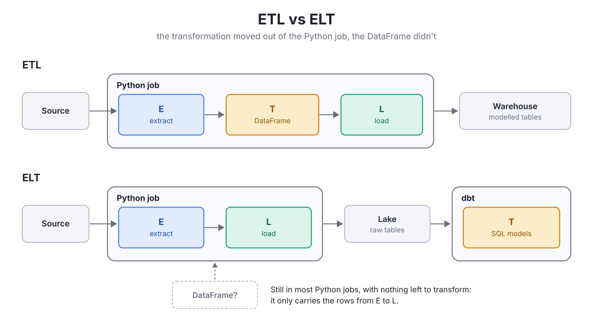
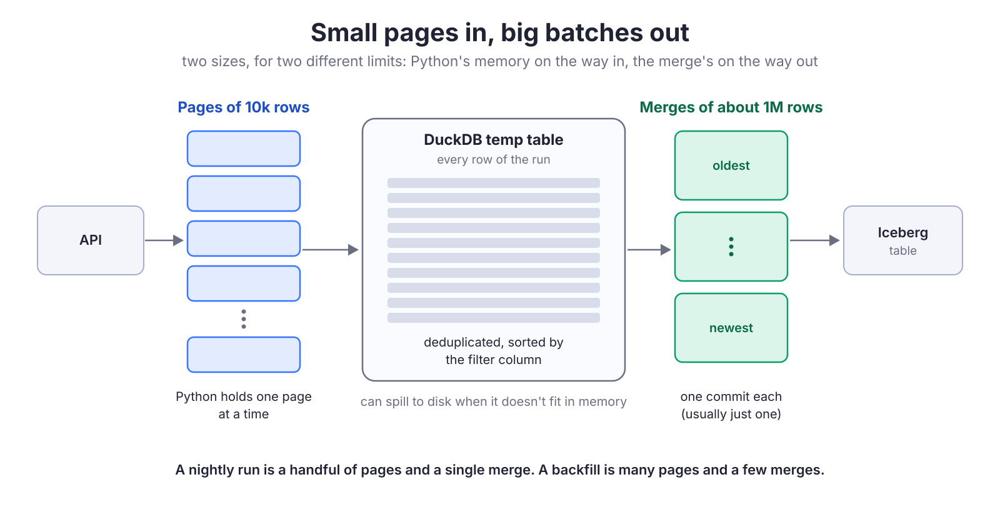
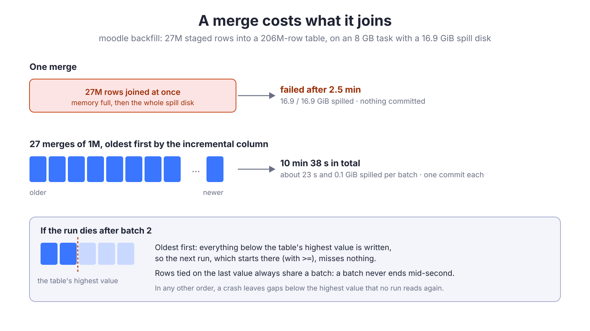

{/*
Target: ~450 lines, the depth and punch of "You Probably Don't Need Spark".
Audience: data engineers who write extraction jobs in Python and reach for pandas out of habit.
Thesis: modern DE is ELT. The E and the L only move rows, and the T is SQL in dbt (or an
equivalent), so a DataFrame has no job left in production: it's a bag for rows that costs memory
and changes the data. Arrow builds the table, DuckDB writes it. DataFrames belong in notebooks,
and notebooks don't go to production.
Controversial on purpose, backed only by numbers we measured (ECS runs and a local benchmark).
TODO before release: date, slug check.
*/}

<script type="module" src="/js/posts/0075-plots-dataframes.js"></script>

> [!info] Part two
> This post continues <FancyLink linkText="You Probably Don't Need Spark" url="https://villoro.com/blog/duckdb-instead-of-spark/" dark="true"/>, where we moved our database extractions to DuckDB. There, DuckDB reads the database itself and the rows never reach Python. This one is about the other sources: APIs, SDKs and anything else where the data reaches Python as a list of dicts (or something like it) at some point. The rows have to go through Python there, and this post is about what they should look like when they do.

## ETL is over, and so is the DataFrame in the middle

Most extraction jobs that read an API or an SDK have these three lines somewhere:

```python
records = api.get_all("Task")       # a list of dicts
df = pd.DataFrame(records)
wr.athena.to_iceberg(df, ...)
```

This made sense with **ETL**. The job extracted the data, transformed it, and loaded the result, and the transformation happened in Python. pandas was the natural tool for that: joins, aggregations and cleaning, all before loading.

Today most of us do **ELT** instead. The job extracts the raw data and loads it as it is, and the transformation happens later, in SQL, with dbt or something similar. The T moved out of the job.



The DataFrame, however, stayed in most jobs. In an ELT pipeline it has nothing left to transform, so it only carries the rows from the extract to the load. And that is not free: it uses much more memory than the data it holds, which forces the job to write in small chunks, and it changes some values on the way (integers with NULLs become `1.0`, nested objects become Python reprs instead of JSON).

> [!abstract]
> I think **you don't need DataFrames for data engineering**, neither pandas nor Polars. The T belongs in SQL, and the E and the L only move rows, which Arrow and DuckDB do well without a frame in the middle. In this post I show how we removed it from our extraction jobs, what we got, and what we learned on the way. (When the transformation itself has to happen in Python, for an ML model for example, that's a different story: I cover it at the end.)

## What the DataFrame costs

We didn't use a DataFrame because we wanted one. When we started writing Iceberg tables with the Glue catalog, the only way we found was awswrangler's `to_iceberg`, and it takes a pandas DataFrame. So every job built one, and passed it to a shared writer, `write_iceberg`, which did what most loaders do:

1. Lowercase the column names.
2. Drop the rows without a key, and the duplicated keys.
3. Cast every column to text (we land raw data as strings, and type it in dbt).
4. Hand it to awswrangler, which writes it to the Iceberg table (through Athena, as an insert or a `MERGE`).

None of those steps needs a DataFrame. But since the rows were in one, each step paid for it.

### Where the memory goes

It's easy to think the DataFrame is the expensive part. It isn't: most of the memory goes to the rows themselves, as Python objects, before pandas even starts.

| Step | What it costs |
| --- | :--- |
| The list of dicts | The biggest part. Every row is a Python dict (a hash table with an entry per key), and every value is a separate Python object with its own header. |
| `pd.DataFrame(records)` | Less than it looks. Text columns are `object` columns, arrays of pointers to the same Python strings. But the dicts and the frame are alive at the same time. |
| Dropping keys and duplicates | Each filter builds a new frame (new arrays of pointers), and `drop_duplicates` hashes every key. |
| `astype(str).where(notnull)` | This one really allocates: a new Python string for every value that wasn't one, then a second pass to put the NULLs back. |
| awswrangler | Converts the frame to Arrow to write the Parquet files of the Iceberg table, and buffers them while it uploads. |

So the memory of a write grows with the number of rows in it, and fast. That's why our jobs wrote in chunks: not because a chunk was a good idea, but because a whole run didn't fit in the machine. A big run was many writes, and many commits to the table.

### What it changes on the way

The DataFrame also changes some of the data:

* **Integers with NULLs become floats.** By default, pandas stores a column of integers with a missing value as `float64` (its nullable `Int64` type avoids it, but you have to ask for it), so `astype(str)` writes `"1.0"` instead of `"1"`. In dbt, we had to cast those columns through a double to get the integer back.
* **Nested objects become Python reprs.** A dict is written as `"{'type': 'Task'}"`, which is not JSON, so `json_extract` in Athena can't read it.

None of these are bugs in pandas. They came from its default types and from how our writer converted them to text.

## "But Polars…"

The first answer I usually get is: use Polars instead of pandas. Polars is much better at this:

* It's columnar and built on Arrow.
* It uses far less memory than pandas.
* It's strict with types.

But it's still a DataFrame, and the problem is not which one. In an EL job there is nothing for a frame to do. And for writing Iceberg, it doesn't help much either:

* **Writing Iceberg is experimental.** Polars' `write_iceberg` is still marked as unstable, and it goes through pyiceberg, which is one more dependency.
* **We want to control the merge.** As I explained in <FancyLink linkText="the trade-off of the previous post" url="https://villoro.com/blog/duckdb-instead-of-spark/#the-trade-off-you-write-the-write-logic" dark="true"/>, writing the merge ourselves with DuckDB is what lets us add metadata to every row (how many times it was written, when it was first exported) and decide how rows behave: which version wins, and what happens to a key that comes twice.
* **Its type inference doesn't like API data**, where the same field can be a number in one row and a string in the next.

What the job really needs is a table in a format the writer understands, and that format is **Arrow**: the in-memory format that DuckDB reads directly, and that Parquet and Iceberg writers work with.

> [!tip] If you want something off the shelf
> `pa.Table.from_pylist(rows)` is the closest thing to what we do, and it's what I would try first. We didn't use it because it infers the types too, and we wanted to decide ourselves how each value lands as text: integers without `.0`, real JSON for nested objects. That's a few lines of Python, shown in the next section.

## `EL` without a frame: rows in Arrow, writes in DuckDB

So we wrote our own loader, `write_records`. It takes the rows as Python has them, a list of dicts or an iterator of pages of dicts, and never builds a frame:

1. **Each page of rows becomes an Arrow table.** One pass per column: each value is turned into text the way we want it, straight into an Arrow array. Arrow keeps a column of strings in a few compact buffers (the bytes, and where each value starts), without a Python object per value.
2. **DuckDB adds the page to a temp table.** It reads the Arrow table in place and copies the rows into its own storage, which can spill to disk when it goes past its memory limit. Then the page, and the dicts behind it, are freed.
3. **When every page is staged, DuckDB writes the Iceberg table**, through the Glue catalog: create, append, overwrite or merge. It's the same engine as in the previous post, so the deduplication, the merge and the metadata columns come for free.

The rows go in and out in different sizes, because each side has a different limit:

* **`In`: small pages of 10k rows.** The limit here is Python's memory: a page is a list of dicts, the expensive part, so it should be small. Since a page only goes into the temp table, a small one costs very little.
* **`Out`: big merges of about 1M rows.** The limit here is the merge: it needs memory for every row it merges at once. Before merging, the staged rows are deduplicated and sorted by the filter column, and then merged oldest first, each batch its own commit.



For a normal run, this is a handful of pages and **one merge**: one commit for the whole run. The batches only show up in a backfill, with millions of rows (more on why in the lessons below). At any moment, Python only holds one page of rows. Everything else is in DuckDB.

For the jobs, the change is small. This is our Salesforce export now: it reads the API in chunks and hands them to the loader as they arrive.

```python
chunks = iter_chunks(sf, batches, table, cols)  # yields lists of dicts, as the API serves them
write_records(
    chunks,
    table.schema_out,
    table.table_out,
    merge_cols=table.merge_cols,
    order_cols=[table.filter_col],  # if an id comes twice, the newest wins
)
```

<Accordion client:load title="The page and the text, in code">

```python
def page_table(rows, as_snake_case=True):
    """The Arrow table of a page of rows. A key missing in a row is NULL."""
    keys = list(dict.fromkeys(key for row in rows for key in row))
    columns = {
        column_name(key, as_snake_case): pa.array(
            [to_text(row.get(key)) for row in rows], pa.string()
        )
        for key in keys
    }
    return pa.table(columns)


def to_text(value):
    """How a value lands in the lake. An integer stays an integer (pandas made it a float)."""
    if value is None:
        return None
    if isinstance(value, str):
        return value
    if isinstance(value, float):
        return None if math.isnan(value) else repr(value)
    if isinstance(value, (dict, list, tuple)):
        return json.dumps(value, ensure_ascii=False, default=to_text)  # JSON, not a repr
    if isinstance(value, datetime):
        return value.isoformat(sep=" ")
    return str(value)  # integers and booleans
```

DuckDB reads the Arrow table by name:

```python
con.register("page", page)
con.execute("INSERT INTO staged BY NAME SELECT *, ? AS p_extracted_at FROM page", [extracted_at])
con.unregister("page")
```

</Accordion>

> [!note] Three metadata columns
> As in our database extractions, every row gets three columns: when it was extracted (`p_extracted_at`), how many times it was written (`_num_writes`), and when it was first exported (`_first_exported_at`).

## What we got

### The memory, measured

To see the difference without AWS in the way, I ran both loaders locally on the same rows: synthetic Salesforce records with about 100 fields, parsed from JSON 2000 at a time, like the real client does. Both stop right before sending anything to AWS, so the numbers are only the memory of preparing the rows (the details are in the [appendix](#appendix-how-we-measured)).

| Rows in one write | 50k | 200k | 500k |
| --- | --- | --- | --- |
| pandas, peak memory | 0.74 GB | 2.45 GB | 5.64 GB |
| Arrow + DuckDB, peak memory | 0.69 GB | 1.01 GB | 1.57 GB |

<canvas id="memory-by-rows" style="width:100%;height:350px;" role="img" aria-label="Peak memory of one write by rows: pandas 0.74, 2.45 and 5.64 GB at 50k, 200k and 500k rows; Arrow and DuckDB 0.69, 1.01 and 1.57 GB">Peak memory of one write: the same numbers as the table above.</canvas>

With small chunks, both cost about the same. The difference is how fast they grow:

* **pandas**: about **11 KB more for every row** in the write. Each row is alive as a dict and in the DataFrame at the same time. At 500k rows it needs 5.6 GB: more than a 4 GB task has.
* **Arrow + DuckDB**: about **2 KB more for every row**. Python only holds one page of dicts, and DuckDB keeps the staged rows in about 0.5 KB each.

> [!success] About 5x less memory per row
> In this benchmark, every extra row costs pandas about 11 KB, and Arrow + DuckDB about 2 KB. That's what changes the job: with pandas, the size of a write is limited by the machine, so a big run is many writes. With Arrow and DuckDB, a whole run fits in one.

### On the real jobs

Then the same comparison on ECS, with the real Salesforce API (I explained how we extract from it in <FancyLink linkText="Extracting data from Salesforce with Python" url="https://villoro.com/blog/extracting-data-salesforce-python/" dark="true"/>), one run at a time so that Salesforce was equally fast for both:

| Run | pandas | Arrow + DuckDB |
| --- | --- | --- |
| `Task`, 10 days (978k rows), merged into a table of 36M, on 8 GB | 6.0 GB peak, 5 merges | **3.2 GB** peak, **1 merge** |
| `Opportunity` (wide rows), 90 days (1.74M rows), on 4 GB | **killed** (out of memory) after 2 chunks | 3.7 GB peak, **1 write** |

> [!success] The short version
> **Half the memory** on the `Task` job, a wide table that now **fits on a smaller machine**, **one commit** per run instead of one per chunk, and **faithful text**: no `.0`, real JSON.

The runs took about the same time with both. That's expected: in these runs the bottleneck was Salesforce, which serves 2000 rows per call. As in the previous post, **no engine makes a source answer faster**. The win here is not speed: it's that the job needs a smaller machine, writes once, and writes the right values.

## What owning the load taught us

Dropping awswrangler means the write is our code now: the merge, the deduplication, the commits. And running DuckDB inside the job means its memory and its disk are our problem too. We found most of these lessons when we pushed the new loader: wider tables, smaller machines, and backfills of millions of rows into tables of tens of millions.

### Avoid big merges: merge in batches

#### We could stage it, but not merge it

> [!failure] Problem: the merge didn't fit, whatever we tried
> A backfill of 5 months of Salesforce `Task` is 3.8M rows, merged into a table of 36M. Staging them was fine on a 4 GB task: all the rows were in DuckDB. But the `MERGE` wasn't: DuckDB spilled 9 GiB to disk and still ran out of memory. Giving DuckDB a smaller share of the memory, so it would spill earlier, only made it fail sooner.

We assumed the size of the destination table was the problem. It wasn't: a merge of 978k rows into the same 36M took 17 seconds. In these runs, what made the difference was **how many rows we merged at once** (and how wide they were), not how big the destination table was. As far as we can tell, DuckDB builds the join from the new rows and streams the destination table, so the table's size costs time more than memory.

#### Merge in batches

> [!success] Fix: merge in batches
> Split the staged rows in batches of about 1M (`max_merge_rows`) and merge them one at a time, each one its own commit. The same 3.8M rows on the same 4 GB task: **4 merges, 6 minutes**, under 1 GiB spilled each.

This also corrects the previous post. There, a moodle backfill failed after filling the disk, and I wrote that this was where one machine stops (the section "How much disk: where one machine stops"). It wasn't the machine, it was the single merge. The same test now, 27M rows into a table of 206M on an 8 GB task:

| Write | Result |
| --- | --- |
| One merge | Failed after 2.5 min: memory full, and the whole spill disk (16.9 GiB) |
| 27 merges of 1M | **10 min 38 s**, about 23 s each, 0.1 GiB spilled |



#### Oldest first, so a crashed run can resume

Batches have a risk: a run can now die halfway, with some batches committed and others not. That's safe only if the batches go **oldest first**, by the column the job uses to continue (`SystemModstamp` in Salesforce). An incremental run starts where the table ends, so if the table is complete up to its highest value, the next run picks up exactly where the crash left it. In any other order, a crash leaves gaps below that value, and no run will read them again. (A backfill is different: the table already has newer rows, so what makes it safe is that a window can simply be run again.)

Many APIs can't give you the rows in that order: some don't sort at all, and some can't sort by the column you filter on. With pandas we worked around it with a temp table: each chunk was written to a temporary Iceberg table as it arrived, and at the end everything was moved to the real table, so the real table never saw a partial run. It worked, but it meant writing every row twice.

Staging gives us a simpler way. The rows are all in DuckDB before the first write, so we **sort them by the filter column ourselves**, and merge them oldest first, whatever order the API used. No temp table, and each row is written once.

> [!tip] Keep ties together
> A batch never ends in the middle of a value: if 30 rows share the same second, they go in the same batch. Otherwise, a job that reads `> last_value` would skip the rows of that second that weren't written.

### Check for duplicates before removing them

Before a merge, the staged rows need one row per key. We used to deduplicate every time, which rewrote the whole staged table.

> [!failure] Problem: 7.5 minutes to remove nothing
> On 1.74M wide `Opportunity` rows, the deduplication took 7.5 minutes, and almost always found nothing to remove.

> [!success] Fix: count first
> Count the repeated keys, reading only the key columns, which is cheap. If there are none, skip it. If there are, delete only the extra rows instead of rewriting the table. Locally, on 1M rows of 200 columns, it went from **13 s to 0.1 s**.

<Accordion client:load title="The deduplication, in code">

The count reads only the key column, so it's cheap even on a wide table:

```sql
-- Rows without a key, and rows that repeat a key
WITH keyed AS (SELECT id FROM staged WHERE id IS NOT NULL)
SELECT
    (SELECT count(*) FROM staged) - (SELECT count(*) FROM keyed) AS keyless,
    (SELECT count(*) FROM keyed) - (SELECT count(DISTINCT id) FROM keyed) AS repeated
```

Only when it finds something, it deletes the extra rows: the ones without a key, and every copy of a key except the newest.

```sql
DELETE FROM staged WHERE rowid IN (
    SELECT rowid FROM staged WHERE id IS NULL
    UNION ALL
    SELECT rowid FROM staged
    WHERE id IS NOT NULL
    QUALIFY row_number() OVER (PARTITION BY id ORDER BY system_modstamp DESC) > 1
)
```

```python
[(keyless, repeated)] = con.execute(QUERY_COUNT_DUPLICATES).fetchall()
if keyless or repeated:
    con.execute(QUERY_DELETE_DUPLICATES)
```

</Accordion>

### Backfill on a column that never changes

The natural way to backfill an incremental table is to run it with an older `min_ts`, in windows on the same column it uses every day. In Salesforce that's `SystemModstamp`, its version of the usual `updated_at` (or `last_modified_at`) column: when the row last changed.

> [!failure] Problem: a window that moves while you read it
> `SystemModstamp` changes every time a row changes. A row edited while the backfill reads it jumps forward, past the rows already read (or out of the window), so it's read later or not at all, and the progress in the logs looks further along than it really is.

> [!success] Fix: use the creation date
> A backfill reads the rows **created** in each window (`CreatedDate`, which never changes), and merges them as usual. Rows that change while it runs are picked up by the next incremental run. 5 months of `Task` per run on a 4 GB task: 64 minutes reading, 6 minutes merging.

> [!warning] Don't run a backfill next to the schedule
> The merge replaces a row with whatever version it has. If the scheduled job writes a newer version of a row while a backfill is running, the backfill can put the older one back, until the row changes again. For tables that must be exact, pause the schedule during the backfill.

### Smaller pages let wide rows fit

With pandas, the chunk size was a trade-off. Each chunk was a write to the lake (and a commit), so we wanted big chunks to keep the number of writes low. But a big chunk is a big DataFrame, so the chunk was as big as the machine allowed.

With staging, that trade-off is gone: each chunk only goes to the DuckDB temp table, and the lake gets one write at the end ([small pages in, big batches out](#el-without-a-frame-rows-in-arrow-writes-in-duckdb)). So the chunk can be small.

> [!failure] Problem: a wide table didn't fit before writing anything
> Our Salesforce reader collected big chunks of rows before handing them to the loader. For `Opportunity`, with hundreds of columns, one chunk of dicts was already too much for a 4 GB task.

> [!success] Fix: smaller chunks
> Salesforce serves 2000 rows per call whatever chunk you ask for, so a bigger chunk is not faster: it only keeps more dicts in Python. With chunks of 10k rows, `Opportunity` fits. When the loader streams, use the smallest chunk that doesn't add calls.

### Look at the whole memory curve

While testing a long backfill, I looked at the first pages, saw the process grow about 18 MB per page, multiplied by the number of pages, and thought we had a memory leak. We didn't: the curve flattened at about 1.5–1.7 GB. It was Python's allocator warming up, plus DuckDB's staged rows, which spill to disk when needed.

> [!tip]
> Log the memory per page (DuckDB's `duckdb_memory()` gives what it holds and what it spilled) and look at the whole run before calling it a leak.

### The spill disk is part of the memory budget

Spilling to disk is what lets DuckDB work on small machines. But the disk is limited too (about 20 GiB on our tasks), and everything that spills shares it: the staged rows of every table running at once, a deduplication, a merge.

Our old moodle backfill is a good example. It read the same table for three brands at the same time: two of them failed while deduplicating (the old version rewrote the staged table), and the third in its single merge. The errors said "out of memory", but the message mentioned `max_temp_directory_size`: it was the disk.

> [!tip]
> Count what spills at the same time, as you would with memory. With the cheaper deduplication and the batched merges, one big table at a time fits comfortably. For more, use time windows, or a task with more disk.

## Where DataFrames still belong: the notebook

None of this means DataFrames are bad. I still use them every week, in notebooks:

* **Exploring data**: looking at a sample, checking a distribution, finding the weird rows.
* **Prototyping**: trying an idea before it becomes a model or a job.
* **ML experiments**: most ML libraries expect a DataFrame, and that's fine there.

> [!important] Notebooks don't go to production
> Once a notebook's logic becomes a pipeline, the transformation is SQL in dbt, and the job around it is EL. Neither needs a frame.

> [!question] "But my ML library needs a DataFrame"
> Then build it where the library needs it, not before. Read the data as Arrow (DuckDB, for example, returns query results as Arrow), and convert it to pandas or Polars right before calling the library. From Arrow that conversion is usually cheap (numeric columns can often be shared without a copy), so the DataFrame lives for one function call instead of carrying the data through the whole pipeline.

### And Spark?

Spark is the other DataFrame that shows up in data engineering, and my answer is the same as in the previous post. There are genuine cases for it: data that doesn't fit on one machine, or transformations with big joins and aggregations that need to spread the work across many machines. But that point is much further than most people think, and most extraction jobs are nowhere near it. I wrote about where that point is in <FancyLink linkText="When you do need Spark" url="https://villoro.com/blog/duckdb-instead-of-spark/#when-you-do-need-spark" dark="true"/>.

And even when you do need it, that's for the T. The E and the L of an API still move rows, and those still don't need a frame.

> [!tip] An API decides the speed, not your cluster
> When you read from an API, an SDK or any other external service, the limit is usually the service: how many rows it returns per call, how many calls it allows at once, and how fast it answers. Salesforce serves 2000 rows per call whatever you do. A cluster doesn't make those calls faster, it mostly adds machines that wait.

## Conclusion

The DataFrame got into our extraction jobs with ETL, when the job did the transformation and pandas was the tool for it. With ELT the transformation moved to SQL, but the DataFrame stayed, and all it did was carry rows from the extract to the load, using several times their memory and changing some values on the way.

Arrow and DuckDB do that job better. Python keeps one small page of rows at a time, DuckDB stages the rest, and the lake gets one write per run. For us that meant about 5x less memory per row in our benchmark, half the memory on our `Task` job, a wide table that now fits on a smaller machine, and faithful text: no `.0`, real JSON. The price was owning the write logic, and learning a few things about merges, backfills and disks on the way.

> [!tip] Next time you write an extraction job
> Look at what the DataFrame in it actually does. If it only carries rows from the source to the lake, you probably don't need it: build Arrow pages and let DuckDB write them.

If you've removed DataFrames from your jobs too, or found a case in production where you really need one, I'd love to hear about it in the comments.

## Appendix: how we measured

### The local benchmark

The [memory comparison](#the-memory-measured) ran on my laptop, so that AWS and the network wouldn't add noise.

* **The rows** are synthetic, only for this local test (the ECS runs below use the real data). They are shaped like Salesforce `Task` records: about 100 fields (40 text fields, a third of them NULL; 30 numbers, half of them NULL; 15 booleans; 12 dates as ISO text) plus two nested objects, like the `attributes` the API adds to every record. They are parsed from JSON 2000 at a time, like the responses of the real client, so the key strings are shared the same way.
* **The pandas path** does what our old writer did: `pd.DataFrame`, drop the rows without a key, `drop_duplicates`, `astype(str).where(notnull)`, and the conversion to Arrow that awswrangler does before writing. It gets the whole write as one list of dicts, as the old jobs did.
* **The Arrow + DuckDB path** runs our loader's staging: pages of 10k rows, each converted to Arrow and added to the DuckDB temp table, then the duplicates check.
* **Neither** includes sending anything to AWS, or the merge.
* **Memory** is the peak resident memory of the process, sampled every 5 ms, each path in a fresh Python process.

### The ECS runs

* **Where:** AWS Fargate tasks of 4 GB (2 vCPU) and 8 GB (4 vCPU), the sizes our jobs run on. DuckDB gets 70% of the task's memory, and the task has about 20 GiB of disk for the spill.
* **What:** the real Salesforce export and the real moodle export, reading real data from the real sources and writing to copies of the production tables in a scratch database, so the merges ran against tables of the real size (36M and 206M rows).
* **How:** one run at a time, so that Salesforce answered at the same speed for both versions. Memory is the peak of the whole task, as reported in the job's logs.

### Caveats

* **The local benchmark uses synthetic rows.** Its absolute numbers depend on their shape: wider rows or longer texts move both lines up. What carries over is the difference in how fast each path grows. The ECS numbers come from real data.
* **Resident memory is noisy.** Python's allocator keeps memory it has freed, so part of what the Arrow path shows is pages already gone, not live data. It makes the comparison a bit harder on our side, not easier.
* **The ECS peaks are for the whole task**, including everything else the job does, not only the write.
