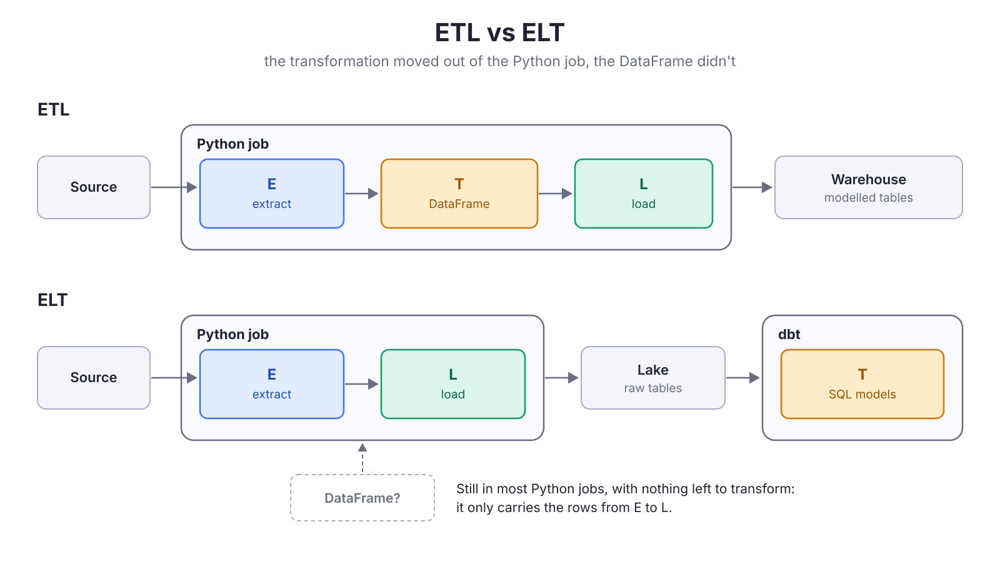

{/*
Target: ~450 lines, the depth and punch of "You Probably Don't Need Spark".
Audience: data engineers who write extraction jobs in Python and reach for pandas out of habit.
Thesis: modern DE is ELT. The E and the L only move rows, and the T is SQL in dbt (or an
equivalent), so a DataFrame has no job left in production: it's a bag for rows that costs memory
and changes the data. Arrow builds the table, DuckDB writes it. DataFrames belong in notebooks,
and notebooks don't go to production.
Controversial on purpose, backed only by numbers we measured (ECS runs and a local benchmark).
Reference draft (not to publish): 9999-no-dataframes.mdx.
TODO before release: hero image (16:9 jpg in src/images/blog/), date, slug check.
*/}

> [!info] Part two
> This post continues <FancyLink linkText="You Probably Don't Need Spark" url="https://villoro.com/blog/duckdb-instead-of-spark/" dark="true"/>, where we moved our database extractions to DuckDB. There, DuckDB reads the database itself and the rows never reach Python. This one is about the other sources: APIs, SDKs and anything else where the data reaches Python as a list of dicts (or something like it) at some point. The rows have to go through Python there, and this post is about what they should look like when they do.

## ETL is over, and so is the DataFrame in the middle

Most extraction jobs that read an API or an SDK have these three lines somewhere:

```python
records = api.get_all("Task")       # a list of dicts
df = pd.DataFrame(records)
wr.athena.to_iceberg(df, ...)
```

This made sense with **ETL**. The job extracted the data, transformed it, and loaded the result, and the transformation happened in Python. pandas was the natural tool for that: joins, aggregations and cleaning, all before loading.

Today most of us do **ELT** instead. The job extracts the raw data and loads it as it is, and the transformation happens later, in SQL, with dbt or something similar. The T moved out of the job.



The DataFrame, however, stayed in most jobs. In an ELT pipeline it has nothing left to transform, so it only carries the rows from the extract to the load. And that is not free: it uses much more memory than the data it holds, which forces the job to write in small chunks, and it changes some values on the way (integers with NULLs become `1.0`, nested objects become Python reprs instead of JSON).

> [!abstract]
> I think **you don't need DataFrames for data engineering**, neither pandas nor Polars. The T belongs in SQL, and the E and the L only move rows, which Arrow and DuckDB do well without a frame in the middle. In this post I show how we removed it from our extraction jobs, what we got, and what we learned on the way.

## What the bag costs

We didn't use a DataFrame because we wanted one. When we started writing Iceberg tables with the Glue catalog, the only way we found was awswrangler's `to_iceberg`, and it takes a pandas DataFrame. So every job built one, and passed it to a shared writer, `write_iceberg`, which did what most loaders do:

1. Lowercase the column names.
2. Drop the rows without a key, and the duplicated keys.
3. Cast every column to text (we land raw data as strings, and type it in dbt).
4. Hand it to awswrangler, which writes it to the Iceberg table (through Athena, as an insert or a `MERGE`).

None of those steps needs a DataFrame. But since the rows were in one, each step paid for it.

### Where the memory goes

It's easy to think the DataFrame is the expensive part. It isn't: most of the memory goes to the rows themselves, as Python objects, before pandas even starts.

| Step | What it costs |
| --- | --- |
| The list of dicts | The biggest part. Every row is a Python dict (a hash table with an entry per key), and every value is a separate Python object with its own header. |
| `pd.DataFrame(records)` | Less than it looks. Text columns are `object` columns, arrays of pointers to the same Python strings. But the dicts and the frame are alive at the same time. |
| Dropping keys and duplicates | Each filter builds a new frame (new arrays of pointers), and `drop_duplicates` hashes every key. |
| `astype(str).where(notnull)` | This one really allocates: a new Python string for every value that wasn't one, then a second pass to put the NULLs back. |
| awswrangler | Converts the frame to Arrow to write the Parquet files of the Iceberg table, and buffers them while it uploads. |

So the memory of a write grows with the number of rows in it, and fast. That's why our jobs wrote in chunks: not because a chunk was a good idea, but because a whole run didn't fit in the machine. A big run was many writes, and many commits to the table.

### What it changes on the way

The DataFrame also changes some of the data:

* **Integers with NULLs become floats.** pandas stores a column of integers with a missing value as `float64`, so `astype(str)` writes `"1.0"` instead of `"1"`. In dbt, we had to cast those columns through a double to get the integer back.
* **Nested objects become Python reprs.** A dict is written as `"{'type': 'Task'}"`, which is not JSON, so `json_extract` in Athena can't read it.

None of these are bugs in pandas. They are what happens when you use a tool built for analysis as a container for rows.

## "But Polars…"

{/*
Short. Polars fixes the memory and the types, but it's still a frame with nothing to do; Arrow is
already the format DuckDB, Parquet and Iceberg speak. pa.Table.from_pylist: close to what we do,
but it infers types; we decide how each value lands as text.
*/}

## EL without a frame: rows in Arrow, writes in DuckDB

{/*
The design with the diagram: a page of dicts -> Arrow table -> DuckDB temp table (spills) -> one
write into Iceberg (Glue). Python holds one page at a time.
The code, short: the Salesforce job barely changes (write_records call). Page and to_text in an
Accordion.
One-way door callout (metadata columns).
*/}

## What we got

{/*
Local benchmark: the slope chart (11 KB vs 2 KB a row; ~0.7 GB both at the old 50k chunk).
ECS table: Task 10 days into 36M (6.0 vs 3.2 GB), Opportunity 90 days on 4 GB (pandas killed,
DuckDB 3.7 GB). Faithful data, one commit, same speed: the source decides it.
*/}

## What owning the load taught us

{/*
Dropping awswrangler means the write logic is ours. Short problem/fix callout pairs:
- A merge costs what it joins (the one with its table and diagram): batches of 1M, oldest first,
  ties together; "I was wrong about the disk" correction of the previous post.
- Check for duplicates before deduplicating (7.5 min -> 0).
- Backfill on a column that never changes (CreatedDate, not SystemModstamp).
- Chunk size only costs memory (Salesforce serves 2000 rows a call).
- Look at the whole memory curve before calling a leak.
- The spill disk is part of the memory budget.
*/}

## Where DataFrames still belong: the notebook

{/*
Exploration, prototyping, ML experiments: great there, and they should stay there.
Notebooks don't go to production: once the logic becomes a pipeline, the T is SQL in dbt and
the job around it is EL.
"My ML library needs a DataFrame": build it at the edge, from Arrow, when the library asks for
it (close to free); the frame doesn't carry the data through the pipeline.
*/}

## Conclusion

{/*
EL moves rows, the T is SQL, so the frame has no job left in production. Closing quote.
*/}

## Appendix: how we measured

{/*
The local benchmark (synthetic Salesforce-like rows, parsed from JSON 2000 at a time, RSS
sampled every 5 ms, what each path includes and leaves out). The ECS runs (Fargate M and L,
copies of production tables in a scratch database, one run at a time). Caveats.
*/}
