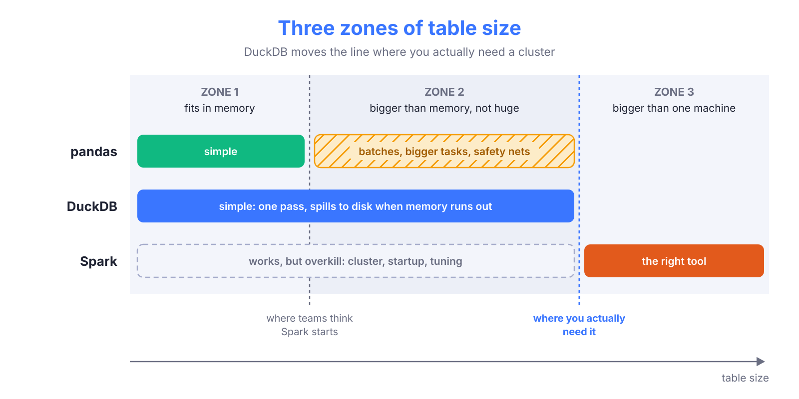
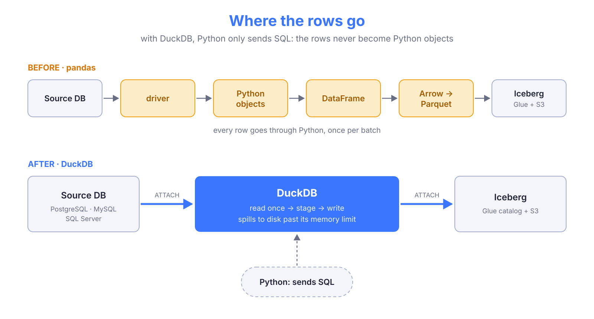
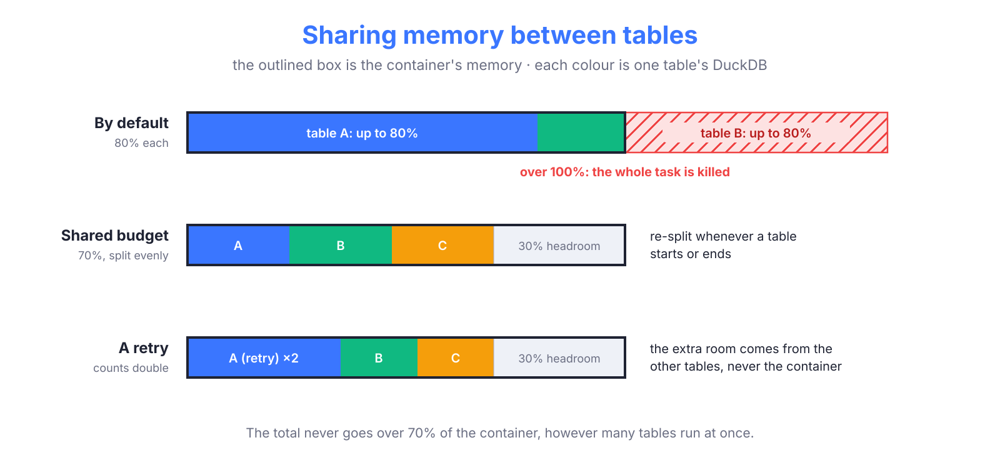

{/*
Target: ~450 lines. Audience: data engineers who know the problem and want to copy
the approach or just see another way. Thesis: you can move data from RDS to the lake
(and back) without Spark, and it will likely be faster and cheaper than anything else.
*/}

## Spark by default

Ask a data team how they move tables from a relational database into their data lake, and there is a good chance the answer includes Spark. Glue jobs, EMR, Databricks: the tool changes, the reflex does not.

> It's data engineering, so it's Spark.

Spark is a great tool for a specific problem: data that does not fit on one machine. But **very few teams have that problem**. Most companies run on a handful of application databases with tables of thousands to a few hundred million rows. That is not big data. It is data that a single, fairly small machine can move.

When you use Spark for it anyway, you pay for things you don't need:

* **A cluster**, even if one node would do.
* **Startup time**, often longer than reading the table itself.
* **Configuration and operations**: executors, partitions, memory settings, and the knowledge to tune them.

> [!abstract]
> This post is about the alternative. You can move data between RDS and an Iceberg lake **without Spark**, on one small machine, and it will probably be faster and cheaper than anything else you might think of. I'll show how we did it with DuckDB, and what we got when we migrated our extractions from pandas.

## Where the frontier really is

When I think about moving a table out of a database, I think in three zones:



Many teams start in zone 1 with pandas, and it works. Then a table grows, a task gets OOM-killed, and the next step feels obvious: "pandas doesn't scale, let's use Spark." The jump goes straight from zone 1 to zone 3.

Zone 2 is painful with pandas because everything has to fit in memory at once. So you start working around it:

* **Batches.** Read the table in chunks (`WHERE updated_at > x ORDER BY ... LIMIT n`), which needs a sortable key per table and a batch size tuned per source. Each batch is another query, often on a column without an index, so a table read in 20 batches is scanned about 20 times.
* **Bigger tasks** for the big tables, and a separate job for the rest.
* **Safety nets**: a cap on the number of batches so a run can't go forever, and a "safe mode" for backfills.

Each workaround is reasonable on its own. Together, they make a simple job complicated, and that complexity is what makes Spark look attractive.

**DuckDB changes where the line is.** It runs inside your Python process and does not need the whole table in memory: when it runs out, it spills to disk and keeps going. A table bigger than RAM is read in one pass, with no batches. If you haven't used it, I wrote an intro in <FancyLink linkText="DuckDB and Beyond" url="https://villoro.com/blog/duckdb-fast-analytics/" dark="true"/>.

> [!tip] How far is the frontier?
> One of our SQL Server databases, **202 tables and 300M rows**, is extracted **in full** (not incrementally: every row of every table, read and written to the lake) in about **30 minutes** on a single **4 vCPU / 8 GB** task.
>
> With pandas the same extraction took two jobs, one of them running almost 2.5 hours on a 16 GB task just for the biggest tables. Before pandas, this same job ran on Spark and took around 40 minutes, so one small DuckDB task is even a bit faster than the cluster, at a fraction of the cost.

That's 300M rows on a machine smaller than most laptops. The line isn't infinitely far (one machine eventually runs out of disk, more on that later), but most teams are nowhere near it.

## The idea: let the engine move the data

Our old pipeline was the obvious one: read a batch with `pandas.read_sql`, write it to the lake, repeat. It works, but every row makes a long trip: from the database driver to Python objects, to a DataFrame, to Arrow, to Parquet. Most of that is Python doing work that a database engine does much better.

DuckDB can skip the whole trip because it can **attach** both ends:

* **The source database.** An attached database looks like one more schema in DuckDB: you can `SELECT` from its tables, or send it a query to run on the server.
* **The lake.** The Iceberg extension attaches an AWS Glue catalog, and DuckDB can create and write Iceberg tables in it.

With both ends attached, moving a table is a SQL statement. The rows go from the source to S3 inside DuckDB's engine, and Python becomes an orchestrator: it builds the SQL, runs it and logs.



These are the extensions we use, all of them installed with a single `INSTALL`:

| Connects to | Extension | Docs |
| --- | --- | --- |
| PostgreSQL | `postgres` (core) | <FancyLink linkText="PostgreSQL extension" url="https://duckdb.org/docs/stable/core_extensions/postgres/overview" dark="true"/> |
| MySQL | `mysql` (core) | <FancyLink linkText="MySQL extension" url="https://duckdb.org/docs/stable/core_extensions/mysql" dark="true"/> |
| SQL Server | `mssql` (community) | <FancyLink linkText="mssql extension" url="https://duckdb.org/community_extensions/extensions/mssql" dark="true"/> |
| Glue / Iceberg | `iceberg` (core) | <FancyLink linkText="Iceberg catalogs" url="https://duckdb.org/docs/stable/core_extensions/iceberg/catalogs" dark="true"/> |

In its simplest form, the whole idea fits in a few lines:

```sql
INSTALL postgres; LOAD postgres;
INSTALL iceberg; LOAD iceberg;

-- The source, read-only
ATTACH 'host=... dbname=app user=... password=...' AS src (TYPE postgres, READ_ONLY);

-- The lake: a Glue catalog, addressed by AWS account id
ATTACH '<aws account id>' AS lake (TYPE iceberg, ENDPOINT_TYPE 'glue');

-- Move a table
INSERT INTO lake.bronze.users
SELECT * FROM src.public.users;
```

No DataFrame, no batches, no driver loop. The real version has a few more steps (staging, merges, types that need a cast), which I'll show in the next section.

> [!tip] It works the other way too
> An attached database is writable, so the same trick moves data from the lake back to the database: `INSERT INTO pg.public.table SELECT ... FROM lake.gold.table`. No Spark in that direction either.

I already hinted at this in the "acting as a data mover" part of <FancyLink linkText="DuckDB and Beyond" url="https://villoro.com/blog/duckdb-fast-analytics/" dark="true"/>. This time it's not a toy example: it's what runs our extractions every night.

## How it works

The snippet above is the idea. The real thing has a few more steps, but not many more: the whole engine is about 1,300 lines of Python, adapters for three databases included. For each table, it does three things:

```python
def extract_one(source, table, query):
    """Moves one table to the lake with DuckDB. Returns the number of rows written."""
    with DuckDBEngine(source) as engine:  # 1. attach the source
        engine.connect_lake()             #    ...and the Glue catalog
        engine.stage(table, query)        # 2. read the source once, into a temp table
        return engine.write(table)        # 3. create, append, merge or overwrite
```

All the snippets in this section are simplified versions of our code.

### Attach

`DuckDBEngine` opens an in-memory DuckDB, points its spill folder to a temporary directory, and runs the attach statements of the source. Then it attaches the lake with the AWS credentials of the running task:

```sql
CREATE OR REPLACE SECRET aws_credentials (
    TYPE s3, KEY_ID '...', SECRET '...', SESSION_TOKEN '...', REGION '...'
);

ATTACH '<aws account id>' AS lake
    (TYPE iceberg, ENDPOINT_TYPE 'glue', DEFAULT_SCHEMA 'default');
```

### Stage

Staging reads the source table into a DuckDB temp table, in a single query:

```sql
CREATE OR REPLACE TEMP TABLE staged AS
SELECT
    "id",
    "name",
    upper(CAST("external_id" AS VARCHAR)) AS "external_id",  -- a GUID
    ...
FROM postgres_query('src', ?)  -- the ? is the query that runs on the source
```

This is the step that replaces all the batching. It reads the whole table in one pass, and DuckDB spills to disk when it goes past its memory limit. A few details that matter:

* **The query runs on the source.** `postgres_query` (or `mssql_scan`, or `mysql_query`) sends it to the database as it is, so the incremental filter (`WHERE updated_at > ...`) is evaluated there, with whatever index the source has.
* **The engine writes the query itself.** It reads the source's column types from `information_schema` and builds the `SELECT` from them. That is where every type problem gets fixed (see below).
* **Staging is separate from writing.** By the time the engine touches the lake, all the rows are already read. A slow or failed read never leaves a half-written table.

#### Fixing types while staging

Each database has a few types that DuckDB reads differently from what you expect. Because the engine knows the source type of every column, it can fix them in the query, **preferably on the server**, so DuckDB receives something it reads correctly. These are the ones we found:

| Source | Type | What goes wrong | Fix |
| --- | --- | --- | --- |
| SQL Server | `datetime` | Stored in 1/300 s ticks: read as `.733333` where SQL Server shows `.733` | `CAST(col AS DATETIME2(3))` on the server |
| SQL Server | `varchar` with a non-UTF-8 collation | The bytes arrive undecoded, so accents break | `CAST(col AS NVARCHAR(MAX))` on the server |
| SQL Server | `hierarchyid`, `geography` | The extension fails: `Unsupported SQL Server type UDT` | Converted to hex on the server |
| SQL Server | `uniqueidentifier` | Lower case in DuckDB, upper case in SQL Server. It matters when it is a merge key | `upper(...)` in DuckDB |
| PostgreSQL | arrays | Read as a DuckDB `LIST` | `array_to_json(col)::text` on the server |
| MySQL | `tinyint(1)` | Read as a boolean | `SET mysql_tinyint1_as_boolean = false` |
| MySQL | `0000-00-00` dates | DuckDB can't hold them | `SET mysql_incomplete_dates_as_nulls = true` |

For a SQL Server table, the query that actually runs on the server ends up looking like this:

```sql
SELECT
    [id],
    CAST([name] AS NVARCHAR(MAX)) AS [name],
    CAST([created_at] AS DATETIME2(3)) AS [created_at],
    LOWER(CONVERT(VARCHAR(MAX), CAST([org_path] AS VARBINARY(MAX)), 2)) AS [org_path]
FROM (SELECT * FROM dbo.employees WHERE updated_at > '2026-10-25') AS source_query
```

Nobody writes that by hand: the adapter wraps the table's query with one cast per column that needs it.

> [!tip] Leaving columns out
> DuckDB has a handy <FancyLink linkText="SELECT * EXCLUDE" url="https://duckdb.org/docs/stable/sql/expressions/star" dark="true"/> to drop columns without listing the rest: `SELECT * EXCLUDE (password_hash) FROM ...`. Great for columns you don't need, but it drops them **after** reading them. For a column that must never leave the database (a password hash, say), we list the columns we keep in the query that runs on the source instead. That way the value never even crosses the network.

### Write

The staged rows go to the Iceberg table. Which statement depends on the table's state and config:

```python
if not table_exists:
    mode = "create"     # CREATE TABLE ... AS SELECT * FROM staged
elif table.full_refresh:
    mode = "overwrite"  # DELETE + INSERT, in one transaction
elif table.merge_cols:
    mode = "merge"      # MERGE INTO ... ON the merge keys
else:
    mode = "append"     # INSERT INTO ... BY NAME
```

Create, append and merge are one statement each, so each one is a single commit to Iceberg. The overwrite is the interesting one.

#### An overwrite in a single transaction

A full refresh replaces every row of a table. The obvious way would be to drop the table and create it again. DuckDB can't do that on Glue anyway (no `DROP` or `CREATE OR REPLACE` for Iceberg tables), but it's not what you want with Iceberg in any case.

> [!warning] Don't drop an Iceberg table to refresh it
> An Iceberg table keeps a history of snapshots, one per commit. That history is what gives you **time travel** (`FOR TIMESTAMP AS OF ...`) and lets you roll back a bad load. Dropping the table throws all of it away, and leaves a moment with no table at all for anyone reading it. Deleting the rows and inserting the new ones keeps the table and adds one more snapshot to its history.

So we delete and insert, **in one transaction**:

```python
logger.info(f"Replacing every row of {table} (delete and insert in one transaction)")
con.execute("BEGIN")
try:
    con.execute(f"DELETE FROM {table}")
    con.execute(f"INSERT INTO {table} BY NAME SELECT * FROM staged")
    con.execute("COMMIT")
except BaseException as e:
    logger.error(f"Replacing the rows of {table} failed ({e}), rolling back: the old rows stay")
    con.execute("ROLLBACK")
    raise
```

Between `BEGIN` and `COMMIT`, nothing is visible outside DuckDB. The `COMMIT` publishes both changes together as one new Iceberg snapshot, so anyone querying the table (Athena, in our case) sees either the old rows or the new ones. Never an empty table, never half of it. If anything fails in the middle, the `ROLLBACK` throws both changes away and the table stays as it was, and the log says so.

Catching `BaseException` instead of `Exception` is on purpose: it also rolls back on things like a `KeyboardInterrupt`, not only when a query fails.

This write logic is the part awswrangler used to do for us, and the one place where the switch cost real work. More on it in [the trade-off](#the-trade-off-you-write-the-write-logic).

### A new database is one small class

The engine knows nothing about PostgreSQL, SQL Server or MySQL. A source adapter tells it what differs:

| Method | What it does |
| --- | --- |
| `attach_queries` | The statements that make the database available in DuckDB |
| `scan` | The table function that runs a query on the source (`postgres_query`, `mssql_scan`, ...) |
| `columns` | The name and source type of every column of a table |
| `kind` | How to stage each source type (text, timestamp, GUID, JSON, ...) |
| `prepare` | Rewrites the query the way the source needs it |

The PostgreSQL adapter, for example, is less than 100 lines. Its core:

```python
class PostgresSource(Source):
    def attach_queries(self, alias):
        return [
            "INSTALL postgres",
            "LOAD postgres",
            f"ATTACH '{self.conninfo}' AS {alias} (TYPE postgres, READ_ONLY)",
        ]

    def scan(self, alias):
        return f"postgres_query('{alias}', ?)"
```

MySQL was the third database we added, and it took one adapter and a handful of type quirks (a `tinyint(1)` stays an integer instead of becoming a boolean, a `0000-00-00` date becomes NULL).

### Many tables at once

One more thing: we don't move one table at a time. A job submits every table as a separate Prefect task, all in the same Python process, and each task opens its own DuckDB. How many run at once isn't decided in our code but by a <FancyLink linkText="Prefect tag concurrency limit" url="https://docs.prefect.io/v3/develop/task-run-limits" dark="true"/>: the nightly MySQL export submits 469 table extractions, and only a handful run at any moment. The few heaviest tables get a stricter tag with a limit of 1, so they never run together.

## What we got

We moved three kinds of jobs from pandas to DuckDB.

> [!success] The short version
> **70% to 95% less compute** on every job we migrated, every set of parallel jobs collapsed into **a single one**, and the full extraction **5x faster**.

In more detail:

| Migration | Jobs | Wall time | Compute |
| --- | --- | --- | --- |
| SQL Server, full extraction (202 tables, 300M rows) | 2 → **1** | 2 h 24 min → **30 min** (~5x faster) | **90% less** |
| MySQL, nightly incremental export (11 databases) | 11 → **1** | ~25 min → **~20 min** | **~70% less** |
| MySQL, weekly hard-delete check (836M ids) | 12 tasks → **1** | ~49 min → **11 min** (~4x faster) | **~95% less** |

Compute is vCPU-hours: how long each task ran, times its size. The numbers come from real runs on the real sources; the details of each migration, and how each number was measured, are in the [appendix](#appendix-the-migrations-in-detail).

The nightly export is the least impressive line, and that's on purpose. It is incremental (it only reads the rows that changed), so most of its time is spent waiting for MySQL to answer, and **no engine makes a source database answer faster**. Even there, we went from 11 jobs to 1 and used a fraction of the compute.

### Everything got better

> [!important] Fast, cheap, simple: pick three
> There's an old engineering joke: fast, cheap or good, pick two. This migration is the rare case where you don't have to pick.

What I find odd about these results is that **there is no trade-off** in them. Usually you buy speed with money, or simplicity with speed. Here, everything moved in the right direction at once:

* **Faster**: the full extractions take a fraction of the time.
* **Cheaper**: smaller tasks, running for less time. The biggest SQL Server tables needed a 16 GB task with pandas; DuckDB moves the whole database on 8 GB.
* **Simpler**: no batches, no batch sizes per source, no caps or safe modes, and one job per source instead of many. The hard-delete check went from three steps, two jobs and a set of snapshot tables to a single `SELECT id` per table (that one deserves its own post).
* **Less load on the source**: every table is read once, instead of once per batch.

> [!note] I'm not putting a price on it
> At AWS list prices, the absolute savings are small: these are small tasks to begin with. The real win is that the pipeline is simpler and faster. Spending less is a bonus.

The one real cost was writing code that we used to get for free, which is the next section.

## The trade-off: you write the write logic

With pandas, writing to the lake was one call to <FancyLink linkText="awswrangler.athena.to_iceberg" url="https://aws-sdk-pandas.readthedocs.io/en/stable/stubs/awswrangler.athena.to_iceberg.html" company="aws" dark="true"/>. You give it a DataFrame, a `mode`, some `merge_cols` and `schema_evolution=True`, and it figures out the rest.

DuckDB writes Iceberg natively, but at a lower level: it gives you SQL statements, not a "write this table" function. Everything awswrangler decided for us, we now write ourselves. That's about 400 lines of Python, and this is what they do:

| Problem | What we do |
| --- | --- |
| A merge needs one row per key | Deduplicate the staged rows first |
| A new column in the source | Compare with `DESCRIBE` and `ALTER TABLE ... ADD COLUMN` each new one, since DuckDB doesn't evolve the schema by itself |
| `CREATE TABLE` on Glue needs an explicit `location` | Compute the S3 path and the table properties ourselves |
| No `DROP` or `CREATE OR REPLACE` | Overwrite as `DELETE` + `INSERT` in one transaction (see [above](#an-overwrite-in-a-single-transaction)) |
| A `DELETE` writes delete files instead of rewriting data | Run Athena's `OPTIMIZE` and `VACUUM` after every overwrite, or each one keeps the old copy of the table |
| Glue fails a commit now and then (a 502, a conflict) and DuckDB doesn't retry | Retry the commit with a growing wait |

Most of these are a few lines each. Two of them are worth showing.

**The merge.** DuckDB's `QUALIFY` makes the deduplication a one-liner, and then the merge is plain SQL:

```sql
-- One row per key: the latest version wins
CREATE OR REPLACE TEMP TABLE staged AS
SELECT * FROM staged
WHERE id IS NOT NULL
QUALIFY row_number() OVER (PARTITION BY id ORDER BY updated_at DESC) = 1;

MERGE INTO lake.raw.employees AS t
USING staged AS s ON t.id = s.id
WHEN MATCHED THEN UPDATE SET
    name = s.name,
    updated_at = s.updated_at,
    ...,
    _extracted_at = s._extracted_at,
    _num_writes = t._num_writes + 1,          -- how many times this row was written
    _first_exported_at = t._first_exported_at  -- kept from the first time it was seen
WHEN NOT MATCHED THEN INSERT BY NAME;      -- new rows: _num_writes = 1, _first_exported_at = now
```

Owning the merge has a nice side effect: **we decide what happens to every column**, not only the source ones. With awswrangler, an update replaced the whole row. Now each row also carries some metadata about its own history:

* `_extracted_at`: when the row was last extracted.
* `_first_exported_at`: when it first reached the lake, kept across updates.
* `_num_writes`: how many times it has been written. A row that changes every night stands out immediately.

It's two lines in the `MERGE`, and it answers questions like "when did this record first appear?" without digging through Iceberg snapshots.

**The commit retry.** Glue's Iceberg endpoint fails a commit every now and then, and retrying a write is not always safe: a `502` can mean the commit landed anyway, and appending the same rows twice duplicates them. So before retrying a create or an append, we check whether the rows are already there:

```python
for attempt in range(1, COMMIT_TRIES + 1):
    try:
        write_rows()
        return
    except duckdb.Error as error:
        if not is_transient(error) or attempt == COMMIT_TRIES:
            raise
        logger.warning(f"Committing to {table} failed ({attempt=}): {error}")
        if mode in ("create", "append") and rows_landed(table):  # by this run's extraction timestamp
            logger.warning("The rows are in the table already, not writing again")
            return
        time.sleep(WAIT_SECONDS * 2 ** (attempt - 1))
```

The wait doubles after every attempt (5 s, 10 s, 20 s...): an **exponential backoff**, so a struggling Glue gets more breathing room each time. A merge or an overwrite gives the same table when run twice, so those are simply retried.

We wrote the loop by hand because of the "did it land?" check in the middle. If you only need the retries, <FancyLink linkText="backoff" url="https://github.com/litl/backoff" dark="true"/> gives you the same in a decorator:

```python
@backoff.on_exception(backoff.expo, duckdb.Error, max_tries=5, giveup=lambda e: not is_transient(e))
def write_rows():
    ...
```

> [!note] Is it worth it?
> For us, clearly. It's a few hundred lines written once, and every table reuses them. In exchange, we got everything in the previous section. But it's real code that you own: if you just need to dump a few small tables, awswrangler is still the shortest path.

## What we learned

Running many tables in parallel on one machine raises three questions: how many at once, how much memory each one gets, and how much disk. These are the lessons we learned answering them.

### How many at once: the source decides

Once the rows stop going through Python, the slowest part of the pipeline is the database you read from. And a source database doesn't get faster because you ask it more things at once. The first knob everyone turns, **more parallel reads, often does nothing**, or makes it worse: the tables just slow each other down.

We tried more concurrency, a machine twice as big and letting the heaviest tables run in parallel. None of them made a run meaningfully faster, and most of them made it more expensive.

<Accordion client:load title="The measurements">

On the MySQL jobs:

* **More concurrency, same time.** The hard-delete check with 6 tables at a time took 11m23s. With 10 at a time, 12m20s, and 55% more compute.
* **A bigger machine, same time.** The nightly export took 21m26s on 8 vCPU / 16 GB, and 21m33s on 4 vCPU / 8 GB.
* **Parallel reads slow each other.** The biggest table took 347 s when it ran alone, and 620 s with other tables reading at the same time.

On SQL Server, we assumed that running the seven heaviest tables one by one was the bottleneck, and let four of them run in parallel instead. The run took about as long (29.5 vs 30.8 minutes), and the total task time grew by a quarter, because every table got slower.

</Accordion>

> [!tip] Find the point where the source stops feeding you faster, and stay there
> Measure with the concurrency you have before adding more. If the tables slow each other down, neither more threads nor a bigger machine will help. Only a faster source would.

### How much memory: share it between the tables

When DuckDB runs out of memory, it **spills**: it writes the data it has already processed to a temporary folder on disk and reads it back when it needs it. That's what lets it read a table bigger than its memory. But running several tables at once gave us two memory problems.

> [!failure] Problem: every table thought it had the whole machine
> By default, each DuckDB may use up to 80% of the machine's memory, and it knows nothing about the other DuckDBs in the same process. Stage two big tables at once, and together they can ask for more memory than the container has. Nobody gets an error: the operating system kills the whole task (an *OOM kill*, exit code 137), and every table running in it fails.

> [!success] Fix: a shared budget
> All the DuckDBs in a process share 70% of the container's memory, split evenly. Each time a table starts or ends, the split is recalculated and every running DuckDB gets its new `memory_limit`, even in the middle of a query.

> [!failure] Problem: one step that doesn't fit
> Spilling isn't magic. Think of a desk and a filing cabinet: finished pages go to the cabinet (disk), but the page you're working on has to fit on the desk (memory). A table with very long texts can need more room for a single step than its share. This time DuckDB raises an out-of-memory error, and only that table fails.

> [!success] Fix: retry with a bigger share
> Prefect retries the failed table, and the retry counts double when the memory is split (triple on the second retry). The extra room comes from the other tables, not from the container.



With both in place, the whole nightly MySQL export peaks at 2.3 to 3.4 GB on an 8 GB task.

<Accordion client:load title="The memory split, in code">

```python
MEMORY_FRACTION = 0.7  # of the container, shared by every DuckDB alive in the process
ENGINES = []           # the DuckDBs alive right now
ENGINES_LOCK = threading.Lock()


def share_memory():
    """Gives each live engine its part of the budget. Call it when one starts or ends."""
    limit_mb = get_container_memory_mb()
    mb_per_weight = limit_mb * MEMORY_FRACTION / sum(e.weight for e in ENGINES)
    for engine in ENGINES:
        share_mb = int(mb_per_weight * engine.weight)  # weight is 2 on a retry, 3 on the next
        # A separate cursor, because the engine's connection is busy running its query
        engine.control.execute(f"SET memory_limit = '{share_mb}MiB'")
```

</Accordion>

### How much disk: where one machine stops

Spilling moves the problem from memory to disk, and the disk is finite too. Our tasks have about 20 GiB of local disk, and on a big enough table, that's where a single machine stops.

> [!failure] Problem: the disk filled up, and DuckDB called it "out of memory"
> We found it with a backfill: re-reading a year of the heaviest tables, about 196M rows, on a 4 vCPU / 8 GB task. Tables of 15 to 27M rows took 9 to 16 minutes each. But the three largest wide tables (27M, 39M and 67M rows) failed after spilling about 14 GiB. Memory was fine.
>
> The error said out of memory, though. So our "retry with a bigger share" kicked in, and re-read each table three times, 14 to 32 minutes each time, to fail in exactly the same way.

> [!success] Fix: tell them apart, and don't retry a full disk
> A full spill folder mentions `max_temp_directory_size` in the error, so that one is no longer retried. For tables that big, read them in time windows (a month at a time, say), or give the task more disk.

This is the honest edge of the single-machine approach, and the point where a bigger setup starts to make sense.

## When you do need Spark

This post is not "Spark is bad". Spark is the right tool for problems that don't fit on one machine. The point is that **most extractions are not that problem**.

And I'm not saying it from theory: two of the jobs in this post started on Spark.

* **The SQL Server extraction** ran on Spark before pandas. It took around 40 minutes, slightly slower than DuckDB's 30, and cost far more.
* **The MySQL export** was even worse: **one cluster per database, so 11 clusters** every night, to move data that now fits on a single 8 GB task.

> [!abstract] Our path: Spark → pandas → DuckDB
> Spark was overkill, pandas got complicated, and DuckDB turned out to be the middle that was missing.

With that said, these are the signs I'd look for before reaching for a cluster:

* **A single table doesn't fit on one machine's disk.** That's the edge we found in the previous section, and it's a real one. Reading the table in batches (time windows, say) can push it further, but then you're back to the kind of complexity DuckDB removed in the first place.
* **The work is more than moving rows.** Big joins across large datasets, or heavy aggregations that need to shuffle data between machines, are what Spark was built for.
* **You already run Spark well.** If the platform, the team and the knowledge are already there, the extra cost of using it for extractions is much smaller.

And before any of those, remember that one machine goes a long way. A bigger task, more disk, or reading the biggest tables in windows are all cheaper steps than a cluster.

### Before you copy this

If you want to try this approach, these are the questions I'd ask first:

* **Is the source your limit?** Measure with the concurrency you have before adding more. If the tables slow each other down, a bigger machine won't help.
* **Do the types survive?** Compare the new tables with the old ones by value, not by row count. Expect a cast or two for each exotic type, and put them in the source adapter.
* **Is the disk big enough for the biggest spill?** Memory is easy to share between tables. Disk runs out quietly, and DuckDB reports it as out of memory.
* **Are overwrites compacted?** Run `OPTIMIZE` and `VACUUM` after a `DELETE` + `INSERT`, or every refresh keeps the old copy of the table.
* **Do you want a way back?** DuckDB doesn't lock you in, but your own choices might. We decided to add metadata columns (`_num_writes`, `_first_exported_at`) that our old pandas path doesn't write, so for us a table that moves stays moved. Decide that up front, and test on throwaway copies of the tables first. We ran every migration on production infrastructure, writing to separate schemas, as I explain in <FancyLink linkText="One Environment to Rule Them All" url="https://villoro.com/blog/one-environment-prod/" dark="true"/>.

## Conclusion

Spark has become the default answer to "how do we move this data?", and for most teams it's the wrong one. Not because Spark is bad, but because their tables aren't big enough to need it.

pandas is great until a table stops fitting in memory, and then it gets complicated fast. DuckDB fills the gap between the two: it reads a table bigger than memory in one pass, attaches the source and the lake directly, and lets Python do what it's good at, orchestrating.

For us, that meant one job instead of many, 70% to 95% less compute, and full extractions several times faster, on machines smaller than a laptop. The price was owning a few hundred lines of write logic, and learning where one machine stops.

> [!tip] Next time you're about to spin up a cluster
> Ask how big your biggest table really is. If it fits on one machine's disk, try DuckDB first. You might not need the cluster at all.

If you try it, or if you've hit a limit I haven't, I'd love to hear about it in the comments.

## Appendix: the migrations in detail

The numbers behind the [What we got](#what-we-got) table, for those who want them.

### How we tested

We never switched a table blindly. Every migration ran first on production infrastructure, against the real source and on the real task sizes, but writing to separate schemas (the idea from <FancyLink linkText="One Environment to Rule Them All" url="https://villoro.com/blog/one-environment-prod/" dark="true"/>). Then we compared those tables with the production ones **by value**, with `EXCEPT` in both directions, and only switched once they matched.

* **SQL Server**: 156 of the 196 comparable tables matched exactly. The other 40 differed by a handful of rows each, rows that changed in the source between the two runs.
* **MySQL**: 13 of the 15 tables compared in full were identical. The other two differed only by rows that changed between the two runs.

That's also what made the migration gradual: the engine is a setting per table, so we could move a few tables at a time, compare, and move on.

### SQL Server: full extraction

202 tables and 300M rows, read in full every time.

| | pandas | DuckDB |
| --- | --- | --- |
| Jobs | 2: the big tables, one at a time, and the rest | 1 |
| Task size | 8 vCPU / 16 GB for the big tables, 4 vCPU / 8 GB for the rest | 4 vCPU / 8 GB |
| Run time | 2 h 24 min + 12 min | 29.5 min |
| Peak memory | up to 7.3 GB for a single table | 4.4 GB of 8 GB, for the whole run |
| Compute | about 20 vCPU-hours | about 2 vCPU-hours |

Per table, with the same output:

| Table | Rows | pandas | DuckDB |
| --- | --- | --- | --- |
| A wide-ish table | 13.9M | 17:49 | 3:50 |
| A wide table (48 columns) | 12.4M | 24:55 | about 7:00 |
| A narrow table (7 columns), full overwrite | 68M | 31:32 | 6:03 |

The run is lopsided: 169 of the 202 tables have under 1M rows and take about half a second each. Three tables account for most of the time.

### MySQL: nightly incremental export

11 databases of the same application, about 42 tables each, reading what changed in the last 2 days: about 17M rows over 469 table extractions.

| | pandas | DuckDB |
| --- | --- | --- |
| Jobs | 11, one per database | 1, all databases |
| Task size | 2 vCPU / 4 GB each | 4 vCPU / 8 GB |
| Run time | about 25 min (median) | 17 to 22 min |
| Compute | about 5 vCPU-hours | about 1.4 vCPU-hours |

Per table, the gain is small. On the biggest database, run on the same data at the same moment, pandas took 11m11s and DuckDB 9m47s: **about 1.1x faster**. That's the source being the limit, as explained in [What we learned](#how-many-at-once-the-source-decides). The gain is in the jobs and the compute, not in raw speed.

### MySQL: weekly hard-delete check

Some sources really delete rows, and the lake keeps them unless you check: that means reading every id of every table (836M ids) and comparing them with the lake.

| | pandas | DuckDB |
| --- | --- | --- |
| Jobs | 12: 11 id exports (one per database), then a merge | 1, all databases |
| Task size | 1 × 4 vCPU / 8 GB, 4 × 2 vCPU / 4 GB, 6 × 1 vCPU / 2 GB, plus a small task for the merge | 2 vCPU / 4 GB |
| Run time | about 49 min | 11.4 min |
| Compute | 8.5 vCPU-hours | 0.38 vCPU-hours |

How it works, and the safety rules that keep it from flagging every row by mistake, deserve a post of their own.

### Caveats on the numbers

* **The "before" numbers are not a controlled benchmark.** They come from the pandas jobs' own history: averages of recent runs, or one measured night.
* **Compute is vCPU-hours of run time**: each task's vCPUs times how long it ran. Provisioning time is left out on both sides, and only the extraction is counted, not what runs after it.
* **The memory budget changed during the migration** (from 50% to 70% of the container), so not every memory figure is for the same setting.
