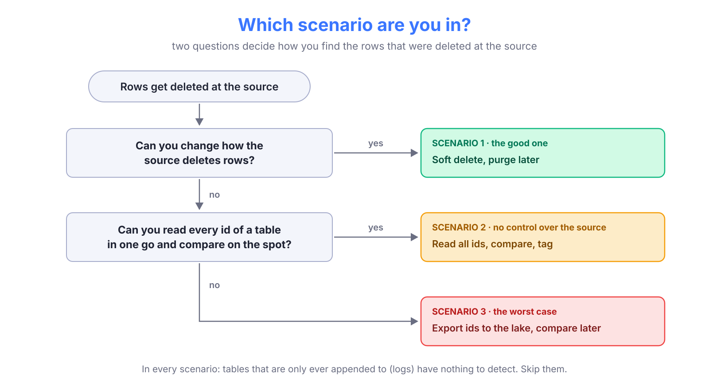

{/*
FREE DRAFT (step 1). Target: ~400 lines. Audience: data engineers who extract
application databases into a lake and either haven't noticed hard deletes yet, or
are fighting them. Thesis: there are three situations, each with a right answer,
and a handful of rules that apply to all of them. After reading, nobody should
have to rediscover them.
TODO: own hero image (the duck one is a placeholder).
*/}

## Hard deletes, and why they hurt

Most extractions into a data lake are **incremental**: every night, read the rows that changed since the last run (`WHERE updated_at > last_run`) and merge them into the lake. It's cheap, it's fast, and it has one blind spot.

When a row is **hard deleted** at the source (`DELETE FROM enrollments WHERE id = 42`), it doesn't change. It disappears. There is no `updated_at` to bump, nothing to read, nothing to merge. The lake keeps the last version it saw, forever, as if the row still existed.

Nobody notices at first. Then the numbers start drifting:

* An enrollment that was cancelled and removed still counts as active.
* A course that was deleted still shows up in a dashboard, with its old students.
* A reconciliation between the lake and the application is off by a few hundred rows, and nobody can say why.

And the drift only grows: every deleted row stays in the lake for good, and nothing in the pipeline ever fails.

### You can't query what isn't there

The root of the problem is simple: **a deleted row leaves no trace to read**. No query against the source returns "the rows that used to be here". So there are only two ways to find out about a delete:

* **The source tells you.** The row isn't removed, it's marked as deleted, and the mark travels to the lake like any other change.
* **You compare.** Read every id the source has now, and look for the ones the lake has but the source doesn't.

The first one is a soft delete. The second one is what you're left with when you don't get one.

> [!abstract]
> There are three ways to deal with hard deletes, and which one you use depends on what you control. **If you can change the source, make it soft delete first.** If you can't, read every id and compare it with the lake. And if you can't even do that in one go, export the ids and compare later. This post goes through all three in depth, plus the rules that keep a comparison from going wrong.

## Soft deletes: a delete that looks like an update

A **soft delete** doesn't remove the row. It marks it:

```sql
-- Hard delete: the row is gone, and the lake never hears about it
DELETE FROM enrollments WHERE id = 42;

-- Soft delete: the row stays, marked as deleted
UPDATE enrollments
SET deleted_at = NOW(),
    updated_at = NOW()
WHERE id = 42;
```

The application then treats marked rows as gone: it filters them out of every screen and every query (`WHERE deleted_at IS NULL`). For its users, the row is deleted. For the lake, **it's just another update**.

There are a few common ways to mark a row:

| Column | Example | Notes |
| --- | --- | --- |
| A timestamp | `deleted_at TIMESTAMP NULL` | `NULL` means alive. The best one: it also tells you *when*, and you will be asked |
| A flag | `is_deleted BOOLEAN` | Simpler, but loses the "when" |
| A status | `status = 'deleted'` | Fine if the table already has a status column |

Whatever the column, one detail decides whether the lake sees it: **`updated_at` must be bumped in the same statement**. That's what makes the incremental extraction pick the row up. A soft delete that doesn't touch `updated_at` is, from the lake's point of view, still invisible.

> [!tip]
> I wrote about this from the other side, as advice for the teams that own the source, in <FancyLink linkText="How to Be Nice to the Data Team" url="https://villoro.com/blog/be-nice-to-data-team/" dark="true"/>. This post is the data team's side.

Soft deletes don't mean keeping every row forever. Tables grow, and sometimes the data must legally go. So sooner or later the application **purges**: it hard deletes rows that were soft deleted a while ago. That's fine, as long as it's done right, which is what scenario 1 is about.

## Three scenarios

Which approach you can use depends on two questions: can you change how the source deletes rows, and if not, can you read all its ids at once?



* **Scenario 1: soft delete, then purge.** You (or a team you can talk to) control the source. The lake is told about every delete, and there is nothing to detect. This is what everybody should do.
* **Scenario 2: read all ids and compare.** You don't control the source: a vendor's product, an open-source application. You read every id in one consistent read and compare it with the lake, in the same process.
* **Scenario 3: export the ids, compare later.** You can't even do that in one go: the tables are too big for your tools, or the source can't serve one big read. You copy the ids to the lake in batches, and compare there.

| | Scenario 1: soft delete | Scenario 2: read all ids | Scenario 3: export ids |
| --- | --- | --- | --- |
| **You need** | Control over the source | Read access, and an engine that can compare a full id set | Read access |
| **Extra jobs** | None | One | Two, plus snapshot tables |
| **Detection delay** | Next incremental run | Next check (weekly, for us) | Up to the snapshot window (~10 days, for us) |
| **Load on the source** | None | One `SELECT id` per table | One `SELECT id` per batch |
| **Gets it wrong when** | The source purges before the lake caught up | A read fails silently | A snapshot is partial or old |

## Scenario 1: soft delete, then purge

This is the one every team should have, and the only one where the lake **doesn't have to guess**. The soft delete itself is the easy part (see above). What makes it safe end to end is how the rows are purged later.

### Purge after a window longer than the worst delay

A purge is a hard delete, so it's invisible to the lake like any other. That's fine, as long as **the lake has seen the soft delete before the purge**. If the purge runs first, the lake never saw the row marked as deleted, and you're back to an invisible hard delete.

{/* DIAGRAM idea: a timeline. Soft delete at t0 → lake extraction picks it up → purge at t0 + W.
    Shows the safe case (lake run inside W) and the unsafe one (a failed week of runs pushes the
    lake past W). */}

The rule is simple: **the retention window must be longer than the worst delay of the lake**, not the usual one.

* Your extraction runs nightly, so the usual delay is one day.
* But the pipeline can be down for a few days (an outage, a holiday, a schema change nobody announced).
* And a backfill can rebuild a table from scratch, which only works if the soft deleted rows are still there.

So a window of a few days is too tight. Agree on one that covers a bad week with margin, and **write it down** where both teams can see it.

### What to ask the application team

This is the part to copy into a ticket:

> [!tip] What to ask the application team for
> * Soft delete with a `deleted_at` timestamp.
> * Bump `updated_at` in the same statement.
> * Purge only rows soft deleted more than *N* days ago, with *N* agreed with the data team.
> * Tell the data team before changing any of the three.

{/* TODO Villoro: if the purge is for GDPR, the lake has to delete the row too, not just keep the
    soft-deleted copy. Do we do anything for that today? Worth a paragraph, or out of scope? */}

### When the source already does this: Salesforce

Some sources give you scenario 1 for free. Salesforce, for example, doesn't remove a deleted record right away: it moves it to the recycle bin, sets `IsDeleted = true`, and only purges it later. If you extract with <FancyLink linkText="queryAll" url="https://developer.salesforce.com/docs/atlas.en-us.api.meta/api/sforce_api_calls_queryall.htm" company="salesforce" dark="true"/> instead of `query`, the deleted records come through as normal updates. Our Salesforce extraction does exactly that (`include_deleted=True` by default), so deletes there need no extra work.

{/* TODO Villoro: confirm the Salesforce extraction is incremental on SystemModstamp/LastModifiedDate
    and that deleting a record bumps it. That's what makes it scenario 1. */}

### A variant: change data capture

If you control the database's infrastructure, but not the application, there's another way to get scenario 1: **change data capture** (CDC). Tools like <FancyLink linkText="Debezium" url="https://debezium.io/documentation/reference/stable/connectors/mysql.html" company="default" dark="true"/> or AWS DMS read the database's own change log (the binlog in MySQL, the WAL in PostgreSQL), where a `DELETE` is an event like any other.

It answers the question directly, but it's a different kind of pipeline: a process that runs all the time, a log retention you have to size (the same "worst delay" rule as above), and more to operate. If you already have it, deletes are solved. I wouldn't set it up just for deletes.

## Scenario 2: no control over the source

Most of the time, you don't get scenario 1. The source is a vendor's product, or an open-source application, and you don't decide its tables or its columns.

That's our case with **Moodle**. We extract 11 Moodle databases (one per brand), about 42 tables each, and Moodle hard deletes rows whenever it wants. We can't add a `deleted_at`, and we wouldn't want to patch Moodle to get one.

So we compare. If an id is in the lake but not in the source anymore, it was deleted.

### The idea: one `SELECT id`, compared on the spot

For each table:

1. **Note the time**, then read every id from the source in a single statement.
2. **Compare** them with the ids in the lake.
3. **Tag** the rows that are gone, and **untag** the ones that came back.

Reading only the `id` column is cheap: the database answers it from the primary key, without touching the rest of the row. And a single statement gives you a **consistent snapshot**: the ids as they were at one moment, not a mix of moments.

We do it with DuckDB, which reads from MySQL with its <FancyLink linkText="MySQL extension" url="https://duckdb.org/docs/stable/core_extensions/mysql" company="duckdb" dark="true"/>, and writes to the Iceberg tables in the lake. The read keeps the ids in a temporary table:

```sql
CREATE OR REPLACE TEMP TABLE ids AS
SELECT CAST(id AS BIGINT) AS id
FROM mysql_query('moodle', 'SELECT id FROM mdl_grade_grades');
```

Then a second query decides, for every id in the lake, whether it was deleted:

```sql
CREATE OR REPLACE TEMP TABLE flags AS
SELECT
    raw.id,
    coalesce(ids.id IS NULL AND raw.extracted_at < :started_at, false) AS is_deleted,
    raw.flagged
FROM (
    SELECT
        id,
        max(p_extracted_at) AS extracted_at,
        bool_or(is_hard_deleted) AS flagged
    FROM lake.moodle.mdl_grade_grades
    GROUP BY id
) AS raw
LEFT JOIN ids ON raw.id = ids.id;
```

{/* Simplified from the real one (the real one casts, since the raw tables are all strings). */}

Two things in there are not obvious, and both are there because of a bug they prevent:

* **`raw.extracted_at < :started_at`.** A row the lake got *after* we started reading ids could have been created after the read, so it's missing from the ids for a good reason. Only rows extracted before the read can be judged. More on this in [the rules](#rules-for-any-comparison).
* **`GROUP BY id`.** The raw table can have more than one row per id, and the next step, a `MERGE`, needs one row per key.

Finally, one `MERGE` does both the tagging and the untagging:

```sql
MERGE INTO lake.moodle.mdl_grade_grades AS target
USING flags AS f
ON target.id = f.id
WHEN MATCHED AND f.is_deleted AND NOT target.is_hard_deleted THEN
    UPDATE SET is_hard_deleted = true, hard_delete_detected_at = :now
WHEN MATCHED AND NOT f.is_deleted AND target.is_hard_deleted THEN
    UPDATE SET is_hard_deleted = false, hard_delete_recovered_at = :now;
```

A `MERGE` gives the same table when you run it twice, so if the commit fails (Glue does, now and then), it's safe to retry.

### Why this needs the right engine

The idea is simple. What makes it hard is the **size of the comparison**. Our biggest table has **184M ids** in a single brand. To compare them, you need all of them at once, plus the ids in the lake, in the same place.

With pandas, that's a problem. Hundreds of millions of ids, twice, as DataFrames, plus the join, on a small task: it runs out of memory long before it finishes. That's why we didn't do this before (see scenario 3).

DuckDB doesn't need everything in memory: when it runs out, it spills to disk and keeps going. And it can read from MySQL and from the lake in the same process, so the join happens right there. I went through what that changes for extractions in general in <FancyLink linkText="You Probably Don't Need Spark" url="https://villoro.com/blog/duckdb-instead-of-spark/" dark="true"/>.

{/* TODO: confirm this link works once 0074 is published (it is a draft now). */}

### What it costs

The whole check, for all 11 brands, is **one job**:

* **397 tables** with data, **836M ids** read.
* About **11 minutes** on a 2 vCPU / 4 GB task, 6 tables at a time.
* **1.7 GB** of memory at the peak: it only reads one column, so it doesn't need more.

Almost all of the time goes to the two biggest reads of `mdl_scorm_scoes_value` (6.5 and 4.7 minutes). The other tables take seconds.

> [!tip] Measure before adding concurrency
> With 10 tables at a time instead of 6, the run took *longer* (12m20s vs 11m23s) and used 55% more compute. The bottleneck is the source, not the task. The full story is in the DuckDB post.

## Scenario 3: when you can't do it on the fly

Sometimes you can't read every id in one go and compare it right away:

* **No engine that spills.** You're on pandas (or something else that needs everything in memory), and the biggest table doesn't fit.
* **A source that can't serve one big read.** The query times out, or a long read would hurt the application.
* **The lake isn't reachable from where you read**, so the comparison has to happen somewhere else (Athena, Spark, your warehouse).

Then the comparison has to be split in two: **export the ids to the lake** first, and **compare later**, inside the lake. This is what we did for Moodle before scenario 2, and it worked for years. It's also much more complicated, and the complications are worth knowing even if you never build it.

### Exporting the ids, in batches

Without one big read, you read the ids in batches. Paging on the primary key is cheap, since the database walks the index:

```sql
SELECT id
FROM mdl_grade_grades
WHERE id > :last_id
ORDER BY id
LIMIT 5000000;
```

Each batch goes to the lake, into a table of id snapshots. Two lessons came with it:

* **Write to a staging table first, then append it all at once.** If the export fails halfway, a partial snapshot in the main table looks like *half the table was deleted*. With staging, a failed export leaves nothing behind.
* **Cap the batches.** A loop that pages "until there are no more ids" needs a limit (we used 100 batches of 5M), or a bug turns it into a job that never ends.

### Comparing later, with snapshots that aren't snapshots

Here's the subtle part. With batches, **the ids are no longer a consistent snapshot**. Batch 1 was read at 01:00, batch 40 at 03:30. "The ids as of when?" has no single answer.

{/* DIAGRAM idea: the batches on a timeline, with a row inserted between batch 1 and 40, and the
    6h margin shown as a shaded band before the newest snapshot. */}

We solved it with a **rolling window**:

* The id export ran **weekly**, and kept the snapshots of the last **10 days**.
* An id counted as alive if it appeared in **any** snapshot in the window.
* A row could only be tagged if it was extracted before the **newest snapshot minus 6 hours**, a margin for how long the export itself took.

The comparison ran in Athena, as one `MERGE` per table, much like scenario 2's, but reading the ids from the snapshot table instead of from memory.

It worked, but look at the price:

* **Two jobs**, one for the ids and one for the comparison, plus a cleanup of old snapshots.
* **A snapshot table per brand**, with its own maintenance.
* **A detection delay of up to ~10 days**: a deleted id had to age out of every snapshot in the window before it counted as gone.
* **About 270 task-minutes** per weekly run (one large task per brand), plus 7 for the comparison. Scenario 2 does the same in 11.

{/* TODO Villoro: the DuckDB post says "12 tasks → 1, ~49 min → 11 min" for this job. Both are
    true (wall clock vs task time), but pick one to show here so the posts don't seem to disagree. */}

> [!note] Still the right answer sometimes
> If you're in one of the situations above, scenario 3 is what works, and the window and the margin are what make it safe. Just don't build it if scenario 2 is possible: every piece of it exists to work around not having one consistent read.

## Rules for any comparison

Scenarios 2 and 3 are both **a comparison**: what's in the lake, minus what's in the source. A comparison has a nasty failure mode: when one side is wrong, it doesn't fail, it **tags everything**. These rules are what keep that from happening.

### Only judge rows the lake had before you looked

A row that's missing from the source ids is only deleted if it **existed when you read them**. A row created after the read is missing too, and it's very much alive.

You need a time to compare with. A source column like `created_at` would do, but not every table has one. What every row in the lake has is **when we extracted it** (`p_extracted_at`). So:

* A row extracted **before** the read started, and missing from the ids: deleted.
* A row extracted **after** the read started: no verdict yet. The next run will judge it.

It also works the other way around: a deleted row stops being extracted, so its `p_extracted_at` freezes, and sooner or later it falls before the read.

### An empty read is a failed read

If the source returns **no ids** for a table that has rows in the lake, the likely story isn't "someone emptied the table". It's a read that failed without an error: wrong database, a permission, a connection that came back empty.

If you trust it, every row in the table gets tagged as deleted. So **stop** instead:

```python
if n_rows_in_lake and not n_ids_in_source:
    raise RuntimeError(
        f"{table}: the source returned no ids but the lake has {n_rows_in_lake} rows, "
        "not tagging them all as deleted"
    )
```

{/* Maybe worth extending: also stop if more than X% of a table would be tagged at once.
    We don't do it today. TODO Villoro: worth suggesting, or leave it out? */}

### Tag, don't delete

When we find a deleted row, we **don't remove it from the lake**. We tag it:

| Column | Meaning |
| --- | --- |
| `is_hard_deleted` | The row is gone from the source |
| `hard_delete_detected_at` | When we noticed |
| `hard_delete_recovered_at` | When it came back, if it did |

Three reasons:

* **It's reversible.** Rows do come back (restored from a backup, or a bug in our own check). Untagging is one `UPDATE`. Un-deleting is a re-extraction.
* **History survives.** "How many enrollments did we have last year" still counts the ones deleted since.
* **The decision moves downstream**, where it belongs. In our dbt project, the cleaning layer of every Moodle model filters `WHERE NOT is_hard_deleted`, and the dimensions keep the flag as metadata.

### Skip what can't be deleted

Some tables are only ever appended to: logs, events, audit trails. Nobody deletes a log line, and they're usually the biggest tables you have. Checking them costs the most and finds nothing, so **leave them out**. For us that's Moodle's `mdl_logstore_standard_log`, the largest table of every brand.

### Don't check what you haven't extracted yet

A table that's new in the source, and not in the lake yet, has nothing to compare. Skip it until the extraction has written it once, instead of failing.

## Which one should you use?

{/* Maybe reuse the decision diagram here, or a short checklist. */}

* **If you can change the source: scenario 1.** Ask for soft deletes with `deleted_at`, a bumped `updated_at`, and a purge window longer than your worst delay. It's the only option without guessing.
* **If you can't, but you can read every id at once: scenario 2.** One job, one `SELECT id` per table, and an engine that can compare hundreds of millions of ids on a small machine.
* **Otherwise: scenario 3.** Export the ids in batches, compare in the lake, and protect yourself with a rolling window and a margin.

And whichever you choose: only judge rows you had before you looked, never trust an empty read, tag instead of deleting, and skip the tables that can't have deletes.

> [!tip]
> If you're extracting incrementally and have never thought about deletes, run one check: count the ids in the source and in the lake for your biggest table. If the lake has more, you have hard deletes, and now you know what to do about them.

{/* TODO: closing line / CTA in Villoro's voice. */}
