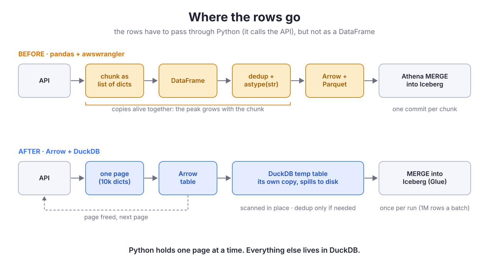
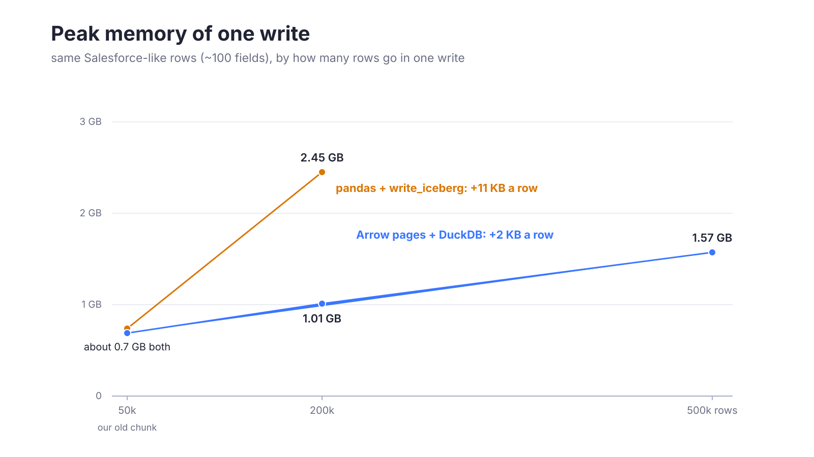
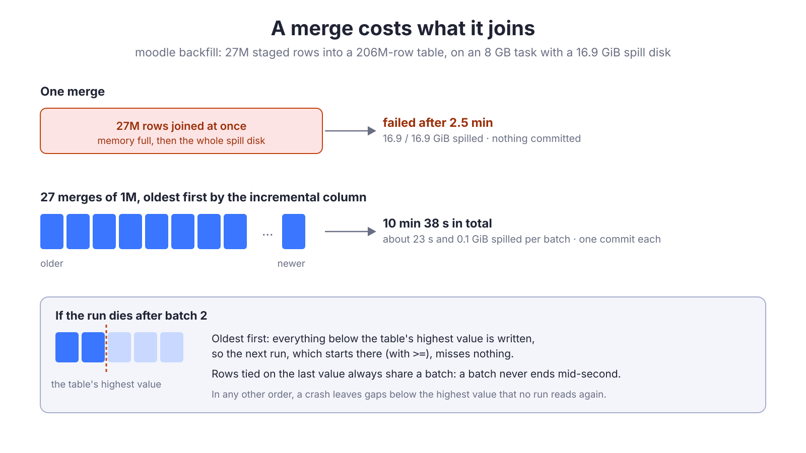

{/*
Target: ~450 lines. Audience: data engineers who write extraction jobs in Python (APIs, SaaS)
and reach for pandas out of habit. Thesis: in a modern stack the transformations live in dbt,
so the extraction job only moves rows; a DataFrame is the wrong container for that. Arrow
builds the table, DuckDB writes it. Sequel to "You probably don't need Spark".
TODO before release: hero image (16:9 jpg in src/images/blog/), date.
*/}

## A DataFrame that does nothing

Look at almost any extraction job that reads an API and loads a data lake, and you'll find the same three lines in the middle:

```python
records = api.get_all("Task")       # a list of dicts
df = pd.DataFrame(records)          # because that's what you do
wr.athena.to_iceberg(df, ...)       # because that's what the writer takes
```

The DataFrame in the middle **does nothing**. No joins, no aggregations, no feature engineering. In a modern stack all of that happens later, in SQL, in dbt. The extraction job only moves rows from A to B, and pandas is just the bag the rows travel in.

It's an expensive bag. Every row it holds costs several times what the data weighs, so the job has to write in small chunks, one commit each. And it changes the data on the way: integers become `1.0`, nested objects become Python reprs instead of JSON. We lived with both for years because "pandas is how you handle data in Python".

> [!abstract]
> This post is about dropping the bag. Since the transformations live in dbt, **an extraction job doesn't need a DataFrame at all**. Arrow builds the table and DuckDB writes it to Iceberg. I'll show how we did it for our Salesforce and API jobs, what it saved, and what owning the write taught us about big merges and backfills, which turned out to be the interesting part.

This is the second half of a story. In <FancyLink linkText="You Probably Don't Need Spark" url="https://villoro.com/blog/duckdb-instead-of-spark/" dark="true"/> we moved our database extractions to DuckDB: there, DuckDB reads the source itself, and the rows never reach Python. An API is different: the rows *have* to pass through Python, because Python is what calls the API. The question here is what they should look like while they do.

## Where the memory goes

Our old writer, `write_iceberg`, took a DataFrame and did what every job needs before a write: lowercase the columns, drop the rows without a key, drop duplicates, cast everything to text (we land raw data as strings), and hand it to awswrangler, which writes Parquet to S3 and runs an Athena `MERGE`.

Not every step copies the data, but every row is paid for several times:

1. **The list of dicts.** Before pandas starts, the job holds every row as a Python dict: a hash table with an entry per key, and a Python object per value, each with its own header. This is the biggest cost, and it's there before any DataFrame.
2. **`pd.DataFrame(records)`.** A second structure over the same values. Text columns become `object` columns, arrays of pointers to the same Python strings, so it's cheaper than it looks, but the dicts and the frame are alive together.
3. **Key cleanup and `drop_duplicates`.** Each filter builds a new frame (new pointer arrays), and `drop_duplicates` hashes every key. It also keeps the *first* row of each key, not the newest.
4. **`astype(str).where(notnull)`.** This one really allocates: a new Python string for every cell that wasn't one already, then a second pass to put the NULLs back.
5. **awswrangler.** Converts the frame to Arrow to write Parquet, and buffers the files it uploads.

The result is a cost per row that grows with the chunk. To keep the job inside its machine, you keep the chunk small (ours were 50k rows), and each chunk is a separate write and a separate commit.

> [!failure] And it changes the data on the way
> * An integer column with a NULL becomes `float64` in pandas, so `astype(str)` writes `"1.0"`, and dbt has to cast it through a double to get the integer back.
> * A nested object becomes `"{'type': 'Task'}"`: a Python repr, not JSON, so `json_extract` in Athena can't read it.

### Why not Polars, or `pa.Table.from_pylist`?

Polars would work about as well as what we built: it's columnar, and DuckDB can read a Polars frame without a copy. But it adds a dependency and nothing that `pyarrow` doesn't already give you, and its type inference refuses mixed columns, which API data loves.

`pa.Table.from_pylist(rows)` is closer to what we do, and it's what I'd try first. We didn't use it because it infers types too, and we wanted to decide how each value lands as text (no `1.0`, real JSON) ourselves.

## Arrow in, DuckDB out

The replacement, `write_records`, takes rows as Python sees them (a list of dicts, or an iterator of pages of them) and never builds a frame:

1. **A page of rows becomes an Arrow table.** One pass per column: each value is normalised to text, straight into an Arrow array. Arrow stores a column of strings as one buffer of bytes plus offsets: no Python object per value.
2. **DuckDB appends the page to a temp table.** It scans the Arrow table in place and copies the rows into its own storage, which spills to disk past its memory limit. The page, and the dicts behind it, are freed.
3. **Once every page is staged**, the same engine we use for the database extractions writes the Iceberg table: create, append, overwrite, or a `MERGE` by key, through the Glue catalog. **One commit per run** (or per million rows on a big merge, more on that later), instead of one per chunk.



The job barely changes. The Salesforce export went from building a DataFrame per chunk to this:

```python
chunks = iter_chunks(sf, batches, table, cols)  # yields lists of dicts, as the API serves them
write_records(
    chunks,
    table.schema_out,
    table.table_out,
    merge_cols=table.merge_cols,
    order_cols=[table.filter_col],  # which row wins when an id comes twice: the newest
    max_merge_rows=1_000_000,       # more on this later
)
```

At any moment Python holds **one page** of rows. Everything else is in DuckDB.

<Accordion client:load title="The page, in code">

```python
def page_table(rows, as_snake_case=True):
    """The Arrow table of a page of rows. A key missing in a row is NULL."""
    keys = list(dict.fromkeys(key for row in rows for key in row))
    columns = {
        column_name(key, as_snake_case): pa.array(
            [to_text(row.get(key)) for row in rows], pa.string()
        )
        for key in keys
    }
    return pa.table(columns)  # the real one also numbers the rows, to break ties in the dedup


def to_text(value):
    """How a value lands in the lake. An integer stays an integer (pandas made it a float)."""
    if value is None:
        return None
    if isinstance(value, str):
        return value
    if isinstance(value, float):
        return None if math.isnan(value) else repr(value)
    if isinstance(value, (dict, list, tuple)):
        return json.dumps(value, ensure_ascii=False, default=to_text)  # JSON, not a repr
    if isinstance(value, datetime):
        return value.isoformat(sep=" ")
    return str(value)  # integers and booleans
```

DuckDB scans the Arrow table by name, without converting it first:

```python
con.register("page", page)
con.execute("INSERT INTO staged BY NAME SELECT *, ? AS p_extracted_at FROM page", [extracted_at])
con.unregister("page")
```

</Accordion>

> [!warning] A one-way door
> Like our database extractions, `write_records` adds two columns to every row: how many times it was written, and when it was first exported. The old writer fails on a table that has them, so a table moves once, for good. We moved one job at a time and compared each table with production first.

## What we got

### The memory, measured

To see where the memory goes without AWS in the way, I ran both paths on the same synthetic Salesforce rows: about 100 fields of mixed types, a third of them NULL, plus the nested objects the API returns, parsed from JSON one response of 2000 rows at a time, like the real client does. The pandas path stops right before awswrangler uploads; the DuckDB path stops before its merge (in the old path, the merge ran in Athena, outside the process).

| Rows in one write | 50k | 200k | 500k |
| --- | --- | --- | --- |
| **pandas** path, peak | 0.74 GB | **2.45 GB** | - |
| **Arrow + DuckDB** path, peak | 0.69 GB | **1.01 GB** | 1.57 GB |
| What DuckDB reports holding | 47 MB | 90 MB | 245 MB |



At 50k rows, the size our old job used, the two paths cost about the same. That's not a coincidence: 50k was the chunk size that kept pandas inside the machine. The difference is the slope. **Each extra row costs the pandas path about 11 KB, and the Arrow path about 2 KB**: the pandas path holds every row of the chunk as dicts and as a frame, the Arrow path holds one page of dicts and DuckDB's copy, which takes about 0.5 KB a row (the same rows are 1.4 KB as Arrow text).

That slope is what changes the job. With pandas, a run of a million rows is twenty writes. With Arrow and DuckDB, it's one.

> [!note] Measuring memory in Python is noisy
> These are the process's resident memory, which doesn't shrink when Python frees objects: part of the Arrow path's growth is the allocator keeping freed pages around, not live data. On a real task, the rest of the process levels off at about 1.5 GB and doesn't grow with the run. The benchmark script is in the [appendix](#appendix-how-we-measured).

### On the real jobs

The same comparison on ECS, against Salesforce, each run alone so Salesforce's speed is comparable:

| Run | pandas | Arrow + DuckDB |
| --- | --- | --- |
| `Task`, 10 days (978k rows), merged into 36M rows, on 8 GB | 19 min, **6.0 GB** peak, 5 merges | about the same time, **3.2 GB** peak, 1 merge (17 s) |
| `Opportunity` (wide rows), 90 days (1.74M rows), on 4 GB | **killed** (out of memory) after 2 chunks | passes, 3.7 GB peak, 1 write (62 s) |

> [!success] The short version
> **About half the memory** on the real jobs, **one commit** per run instead of one per chunk, and the data lands as **faithful text**: no `.0`, real JSON, and the newest row of each key instead of the first. The same speed, because the source decides it: Salesforce serves 2000 rows per call whatever you do.

That last point is worth repeating from the previous post: **no engine makes a source answer faster.** The win is not speed, it's that the job fits in a smaller machine, writes once, and writes the right thing.

## What owning the write taught us

Swapping the writer was the easy part. But dropping awswrangler means the merge, the dedup and the commit are now our code, and running DuckDB in our own process means its memory and disk are our problem. Each lesson below is a problem we hit pushing it (wider tables, smaller machines, backfills of millions of rows into tables of tens of millions), with the fix that's now in the code.

### Chunk size only costs memory

> [!failure] Problem: a wide table didn't fit, before writing anything
> Our Salesforce reader accumulated 50k rows per chunk before handing them over. For `Opportunity`, with hundreds of columns, one chunk of dicts didn't fit in a 4 GB task.

> [!success] Fix: smaller chunks, for free
> Salesforce serves **2000 rows per call** whatever chunk you ask for: a bigger chunk is no faster, it just holds more dicts in Python. We capped chunks at 10k rows, and `Opportunity` fits. When the writer streams, the right chunk is the smallest one that doesn't add calls.

### Measure the whole curve

While testing a long backfill I looked at the first pages, saw the process grow about 18 MB per page, multiplied by the number of pages, and announced a memory leak. It wasn't one. The full curve levelled off at about 1.5–1.7 GB: Python's allocator warming up, plus DuckDB's staged rows, which grew at about 0.3 GB per million rows and spill when they need to.

> [!tip] Don't extrapolate from the first pages
> Log the memory per page (DuckDB's `duckdb_memory()` tells you what it holds and what it spilled) and look at the whole run before calling it a leak.

### Deduplicate only when there is something to drop

Before a merge, the staged rows need one row per key: if the same `id` comes twice, the newest wins. We used to deduplicate unconditionally, which rewrote the whole staged table.

> [!failure] Problem: 7.5 minutes to drop nothing
> On 1.74M wide `Opportunity` rows, the dedup took 7.5 minutes, and almost always found nothing to drop.

> [!success] Fix: count first, then delete the losers
> Count the keyless and repeated rows reading only the key columns, which is cheap. If there are none, skip. If there are, `DELETE` the losing rows by `rowid` instead of rewriting the table. Locally, on 1M rows × 200 columns: **13 s → 0.1 s**. On ECS the step disappeared from the logs.

```sql
-- Only the key column is read: cheap even on a wide table
SELECT count(*) - count(DISTINCT id) AS repeated FROM staged;

-- Only when there is something to drop
DELETE FROM staged WHERE rowid IN (
    SELECT rowid FROM staged
    QUALIFY row_number() OVER (PARTITION BY id ORDER BY system_modstamp DESC) > 1
);
```

### A merge's memory follows what it joins, not the table

This one took the longest to understand, and it's the one I'd most like you to take away.

> [!failure] Problem: a backfill that no setting could fit
> A backfill of five months of Salesforce `Task` is 3.8M rows, merged into a table of 36M. Extracting it was fine on a 4 GB task. The `MERGE` wasn't: DuckDB spilled 9 GiB to disk and ran out of memory anyway. Giving DuckDB a *smaller* share of memory, so it would spill earlier and leave room for the rest, made it fail sooner.

The intuition that failed us was "the target is big, so the merge is big". But a 978k-row merge into the same 36M rows went through in 17 seconds on a task that peaked at 3.2 GB. As far as we can tell from these runs (we inferred it from the numbers, not from a query plan), DuckDB streams the target and builds its join from the staged rows, all their columns: **the merge's memory grows with the rows you merge and their width**, not with the size of the table.

> [!success] Fix: merge in batches
> Split the staged rows into batches of `max_merge_rows` (1M) and merge them one at a time, each its own commit. Same 3.8M rows, same 4 GB task: **4 merges, 6 minutes, under 1 GiB spilled each**.

Our moodle backfill had died the same way. In the previous post, the section on it was titled "How much disk: where one machine stops", and I blamed the machine. It wasn't the machine. The same test today, 27M rows into 206M on an 8 GB task:

| Write | Result |
| --- | --- |
| One merge | **failed** after 2.5 min: memory full, and the whole 16.9 GiB spill disk |
| 27 merges of 1M | **10 min 38 s**, about 23 s each, 0.1 GiB spilled |



Batches bring a new risk: a run can now die halfway, with some batches committed and others not. The order decides whether that's safe.

* **For an incremental run**, merge **oldest first**. The next run starts where the table ends (from its highest `SystemModstamp`), so a run that died after batch 2 leaves the table complete up to that point, and the next run picks up exactly there. In any other order, a crash leaves holes *below* the table's highest value, and nothing ever reads them again.
* **For a backfill**, the order doesn't save you: the table already holds newer rows, and the next scheduled run starts from today. What saves you is that a backfill window can be run again as it is: the merge replaces what's already there.

> [!warning] Keep ties together
> A batch must not end in the middle of a value. If 30 rows share the last second of a batch, and only 10 of them are written before a crash, a job that reads `> last_value` never sees the other 20. We number the batches with a window `count(*)`, which gives every tied row the same number. Our jobs read with `>=` too, which re-reads the boundary; the merge absorbs those rows (they only count one more write).

```sql
SELECT rowid,
    -- An ordered window counts every row tied with the current one: ties share a batch
    (count(*) OVER (ORDER BY system_modstamp) - 1) // 1000000 AS batch
FROM staged
```

### Backfill on a column that never changes

The natural way to backfill an incremental table is to run it with an older `min_ts`, in windows on the same column it filters on, `SystemModstamp` for Salesforce. That's subtly wrong.

> [!failure] Problem: a window that moves while you read it
> `SystemModstamp` changes when a row changes. A row edited in the middle of a backfill jumps to the end of the window, so you read it later or not at all, and the progress you see in the logs is ahead of the real one. (A window can also look smaller than you expect: in our `Task` table, 4.7M of the rows from that period had been deleted, and Salesforce had purged them.)

> [!success] Fix: window on the creation date
> A backfill reads the rows **created** in each window (`CreatedDate`, which never changes) and merges them as usual, ordered by `SystemModstamp`, so the newest version still wins. Five months of `Task` per run on a 4 GB task: 64 minutes reading, 6 minutes merging.

### The disk is part of the memory budget

DuckDB spilling to disk is what makes all of this fit on small machines. But the disk is finite (about 20 GiB on our tasks), and everything that spills shares it: the staged rows of every table running at once, a dedup, a merge. Our old moodle backfill didn't run out of memory: it read the same table for three brands at once, two of them died while deduplicating their staged rows (the old dedup rewrote them), and the third in its single merge. The errors said "out of memory"; the message said `max_temp_directory_size`.

> [!tip] Size the disk like you size memory
> Count what spills at the same time. With the cheap dedup and batched merges, one big table at a time fits comfortably; three at once is still tight. For more, use windows, or a task with more disk.

## When you still want a DataFrame

None of this means DataFrames are bad. They're the right tool when you actually work on the data in Python:

* **Exploring**, in a notebook.
* **Machine learning**, where the libraries expect a frame.
* **Transformations that can't be SQL**, if you really have one.

But an extraction job that reads rows and writes them is not any of those. If the transformations live in dbt, the job's only job is to land the rows, quickly, cheaply, and as they came, and a frame in the middle makes all three worse.

### Before you copy this

* **You own the write logic.** Merge, dedup, schema evolution, commit retries: awswrangler did these for you, and now they're your code. Tools like dlt or pyiceberg cover parts of it; we already had the engine from our database extractions, so writing the rest was small. The previous post covers that trade-off in detail.
* **It's a one-way door per table** if you add metadata columns, as we did. Compare with production before moving each table.
* **Text is still text.** We land everything as strings and type it in dbt. "Faithful" has edges: booleans are `True`/`False` at the top level but `true`/`false` inside JSON, and a float like `1e16` keeps Python's notation.
* **Measure on the real infrastructure.** Every number in the lessons came from ECS runs; a laptop told us nothing about the merges or the disk.

## Conclusion

The DataFrame was never the point of our extraction jobs. It was a habit: the thing you put rows in, in Python. Replacing it with Arrow pages and a DuckDB table cut the cost of each row about five times, halved the memory of our biggest jobs, made a wide table fit on a machine where pandas got killed, wrote each run in one commit, and fixed values we'd been patching in dbt for years.

And owning the write taught us more about our pipelines than the migration itself: a merge costs what it joins, batches must go oldest first and keep their ties, a backfill needs a column that never moves, and the spill disk is part of the memory.

> [!quote]
> Transformations in SQL, rows in Arrow, writes in DuckDB. The DataFrame can stay in the notebook.

## Appendix: how we measured

* **The local benchmark** generates Salesforce-like rows (about 100 fields: 40 text, 30 numeric with NULLs, 15 booleans, 12 dates as ISO text, two nested objects), parsed from JSON 2000 at a time. Each path runs in a fresh process; memory is the process's resident set, sampled every 5 ms. The pandas path reproduces `write_iceberg` up to the Arrow table awswrangler writes; the DuckDB path runs `write_records`' staging and dedup check. Neither includes the network or the merge.
* **The ECS runs** were on AWS Fargate (M: 2 vCPU / 4 GB, L: 4 vCPU / 8 GB), writing to copies of the production tables in a scratch database, one run at a time so Salesforce's load was the same for both writers.
* **Caveats.** The rows are synthetic, so the absolute numbers depend on their shape; the slopes are what carry over. A different API (wider rows, longer texts) moves both lines, not the gap between them.
