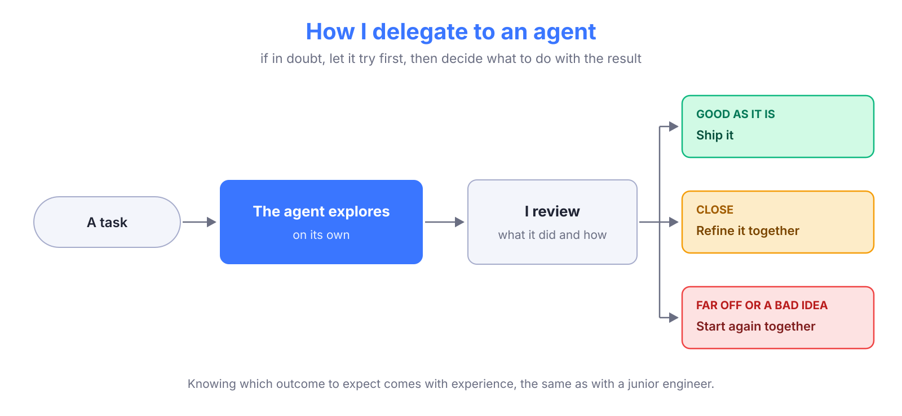

{/* TODO Villoro: hero image (16:9, src/images/blog/9999-...). */}

## I code much less than I used to

I'm a staff data engineer, and before that I spent some years as a data engineering manager. I'm good at coding, and I take pride in the code I write and in the solutions I've designed.

Since I started working with AI agents, that has changed a lot. **Some weeks I write almost no code myself.** Agents write it, and I read it, question it and decide what stays.

I won't pretend it doesn't cost me anything. What I miss most is the feeling of solving something difficult and knowing **I did it**. I still get part of it when an agent and I solve something hard together, but it's not the same.

So I've been asking myself what my value is now, if it isn't writing the code. This post is my honest answer.

> [!abstract]
> My value as a data engineer is in **understanding and evaluating**: deciding what is worth building, where it should live, and judging what gets built. That's where I need to focus, even if it means coding less.

## What agents do well

Let me start by giving agents the credit they deserve, because this is not an anti-AI post.

When I moved our lake writes to DuckDB (you can read about it in <FancyLink linkText="DuckDB instead of Spark" url="https://villoro.com/blog/duckdb-instead-of-spark/" dark="true"/>), the engine ended up in a single file of about 1,000 lines. It worked, but I didn't like it: staging, writing and committing were all mixed together.

{/* TODO Villoro: the old engine.py I found in build/lib is 627 lines. You said ~1000. Which number is right? */}

I asked an agent to propose a better structure. It split each concern into its own mixin and made the engine inherit from all of them:

```python
class DuckDBEngine(StagingMixin, WritingMixin, CommitMixin):
    ...
```

* `StagingMixin` reads from the source and stages the rows.
* `WritingMixin` handles append, merge, overwrite, schema evolution and compaction.
* `CommitMixin` commits to the lake and retries safely when another writer gets in first.

The engine file went down to under 200 lines, and each concern now lives in a file that you can read in one go.

> [!success] It was an elegant solution, and I didn't design it
> What I did was recognize that it was good, and that it was better than what I had.

Agents are fast, they don't get tired of refactors, and they know more libraries than I do. For a well-defined task, they often write better code than I would have written in the same time.

## This was already my job

When I think about it, working with agents is not that different from what I was already doing.

As a senior and later as a staff engineer, a big part of my work has been **looking at what others build, helping them improve it and making sure it's done well**. As a manager, I had to decide every day which tasks a person could do alone and which ones we should do together.

With agents it's the same. I review what they produce, and I propose changes when needed. And I have to decide when an agent can work by itself and when it's better that we work together.

My rule is simple: **if in doubt, let the agent try first**, then look at the result.



* If it's good as it is, it goes in (after my review).
* If it's close, we refine it together.
* If it's far off or a bad idea, we start again from scratch, together.

Some tasks are clear before starting:

* **A new Postgres extraction**: there are plenty of examples in the repo, so I let the agent do it on its own.
* **A new connector**, like the DuckDB one: there is nothing similar to copy, so we work on it together from the start.

Letting it try is cheap, and even a wrong attempt shows me what the agent understood about the task. Knowing which of the three to expect comes with experience, the same way it did with junior engineers.

> [!tip]
> I described how I set up agents to work like this (plans first, shared instructions, lessons that get committed) in <FancyLink linkText="A Multi-Agent Setup That Learns" url="https://villoro.com/blog/multi-agent-setup/" dark="true"/>.

## The questions I ask before building anything

Agents are very good at answering **how do I build this?** They are much worse at asking whether it should be built at all, or where. They will build whatever you ask for, quickly and well.

Most of the value I've added over the years came from asking a few questions before anyone wrote code:

| Question | What it avoids |
| --- | --- |
| Why do you need it, and what will you do with it? | Building the wrong thing |
| What automatic process needs it this fresh? | Paying for real time nobody uses |
| Is it already solved somewhere? | Maintaining a second platform |
| Should this be solved here, or at the source? | Rebuilding logic that belongs to another system |

Here are the stories behind each one.

### Why do you need it?

Someone asked us for an Excel file, every day, dropped somewhere they could pick it up.

Before building anything, I asked why:

> [!question]
> Why do you need an Excel file every day? What will you do with it? Why not a dashboard? Why not some data in the lake, so that something else can read it?

It turned out that the data was the input of an **ML process**. So we wrote it to the lake and let the ML process read it directly from there. That was the end of the Excel problems.

If they had asked an agent instead, they would have had a perfect daily Excel file the same day, and a process to maintain that nobody really needed.

{/* TODO Villoro: any extra detail you want here (team, what the ML process did)? */}

### What automatic process needs it this fresh?

This one has happened many times: people asking for **real-time updates**.

Real time is a huge platform investment. You need streaming infrastructure, and everything downstream needs to handle it. So my counter-question is always the same:

> [!question]
> What **automatic** process needs this data? Would hourly updates work?

* If the data is for a person to review, they don't need real time. Often what they really need is to have the daily data ready when they open the dashboard in the morning, and that's a scheduling problem.
* If it's something like fraud detection, where an automatic process has to act within seconds, then let's talk.

An agent would build a streaming pipeline if you asked for one. It wouldn't ask whether anyone needs the data that fast.

{/* TODO Villoro: a concrete request you can mention? */}

### Is it already solved somewhere?

Over the last few years I've built a monorepo with multiple packages and a CI/CD setup that I'm proud of. I described it in <FancyLink linkText="Scaling ECS Python Deployments with a Modular Monorepo" url="https://villoro.com/blog/monorepo-multimage/" dark="true"/> and <FancyLink linkText="Scalable GitHub Actions for Modern Repos" url="https://villoro.com/blog/github-hooks/" dark="true"/>.

Every once in a while, I see data scientists about to deploy their own Docker image to run some Python. Every time, the conversation goes the same way:

> [!question]
> * Will you have CI?
> * Will CD deploy it automatically?
> * Will you set proper alerts in Slack?
> * Will you have an orchestrator to see the history of past runs?
> * Will you write, from scratch, all the logic to read from and write to the lake?

I know they can do all of it, especially with an agent helping. But I see very little value in them doing it, when it's already solved and it's easy to add a new package to the monorepo.

> [!note] Where the friction comes from
> A PR in the monorepo means a review from my team, and we will push for good practices, because we don't like failures in production. That's slower than shipping your own container. But it's much faster than maintaining a second platform.

### Should this be solved here, or at the source?

This is the story that taught me the most.

> [!quote]
> For years, it was the project I talked about whenever someone asked me for my biggest win. Today I see it as one of my biggest mistakes.

At a previous company, I was asked to build a table that showed **when each store was open or closed**. We didn't have that data. What we had were the events exchanged in the streaming service that, together, decided whether a store was open:

* whether it was within the store's working hours,
* whether there was a force close for the store or for the whole city,
* whether an operator had made a manual change,
* and a few more.

I built something I was quite proud of. Each event added 1 if it was an "opening" event and subtracted 1 if it was a "closing" one (we could get repeated events, so a simple on/off flag didn't work). Summing them with window functions gave me columns like `is_working_hours` and `is_force_closed`, and then some AND/OR logic on top of them told me if the store was open.

```sql
-- Simplified idea, not the real query
SUM(CASE WHEN event_type = 'force_close_start' THEN 1
         WHEN event_type = 'force_close_end' THEN -1 END)
    OVER (PARTITION BY store_id ORDER BY event_at) > 0 AS is_force_closed
```

{/* TODO Villoro: is the sketch above close enough to how it worked? Happy to drop it. */}

It was a difficult and fun problem, and it worked. That's why I shared it as a success story for so long. The problem came later.

The project really belonged to another team, but I had capacity, so I built it. Then I became a manager, and someone else had to maintain it. **The people who took it over left the company quite fast**, and it was a nightmare to maintain.

With experience, I now see it as a failure on my end: we should have said no.

> [!question]
> Should this be solved in the data platform, or in the system that produces the events?

Rebuilding the state of a store from its events inside the data platform was the wrong approach. It had to be solved in the source system: whenever the backend received an event that affected a store, it should have calculated whether the store was open and emitted an event saying so. Working with those events would have been much simpler.

> [!warning] An agent would have built it too
> Today an agent could write those window functions in an afternoon. That makes the wrong solution even more tempting, because it's cheap to build. **What is cheap to build is not cheap to maintain**, and the question of where it should live is still yours.

The same idea appears in <FancyLink linkText="How to Be Nice to the Data Team" url="https://villoro.com/blog/be-nice-to-data-team/" dark="true"/>: most data problems are born upstream, and that's usually where they should be fixed.

## Reviewing what agents produce

Agents produce a lot of code, and someone has to decide which parts add value. Lately I see this a lot with **tests**.

People open PRs written by agents that come with many Python tests. Most of them have very little value. Something like this:

```python
def test_write_modes():
    assert WRITE_MODES == ["append", "merge", "overwrite"]
```

My question for any test is always the same:

> [!question]
> When do you expect this test to fail, and what problem is it saving you from?

For the test above, the only way it fails is when someone changes the constant on purpose, and then they have to change the test too. It catches nothing, and it costs CI time on every run.

I'm not against tests. In our CI, we deploy every Prefect workflow to a local test server (I explained how Prefect deployments work in <FancyLink linkText="Setting Up and Deploying Prefect Server" url="https://villoro.com/blog/prefect-server-setup-configuration-deployment/" dark="true"/>). It's a simple check, but it catches deploys that would fail in production, for example because of import errors. We used to have problems like that once or twice a month, and I didn't like it. That test has a clear answer to my question.

The same applies beyond tests. When I review code, mine or an agent's, I mostly look for:

* **What might fail**, and what happens when it does.
* **Overcomplications**: layers, options and abstractions that nobody asked for.
* **Simpler ways** to get the same result.

Agents tend to add more, not less. Asking for less is usually my job.

> [!warning] Reviewing is tiring
> When agents produce most of the code, reviewing becomes most of the work. It's tiring, and after a long day it's easy to start approving without really reading. I'm working on something to address that, and I'll share it in a future post when it's ready.

## You can externalize code, never thinking

If I got this judgment from years of writing code, how do people who start today get it?

For me, the answer is clear. It's fine if an agent writes the code. It's not fine if nobody understands why the code is the way it is.

> [!tip] If you are starting out
> * **Try things**, even if an agent writes them.
> * **Understand them**: why it works, and what would make it fail.
> * **Decide if they add value**, and drop what doesn't.
> * **Get close to someone with experience**, and ask why they propose what they propose. Why they ask what the Excel file is for, why they worry so much about what might fail, why they push back on a request that is fun to build.

> [!quote]
> You can externalize the code, but you can never externalize the thinking.

{/* TODO Villoro: anything from your manager years about how people learned this? */}

## Looking forward

I think we will keep writing less code. Agents get better every few months, and I don't expect that to stop.

But I also think we still have **quite some years where understanding and evaluating code adds a lot of value**. Someone has to decide what is worth building, check that what gets built is correct, and notice when it's more complex than it needs to be. In my experience, agents are not there yet.

So that's where I'm putting my effort:

* **Asking the questions** from this post before anything gets built.
* **Reviewing** what agents and people produce, and pushing for simpler solutions.
* **Getting better at delegating**: knowing what an agent can do alone, and what we should do together.

Some days I still miss writing the code myself. But I'd rather spend my time where I add the most value, and for now that's understanding and evaluating what gets built.
